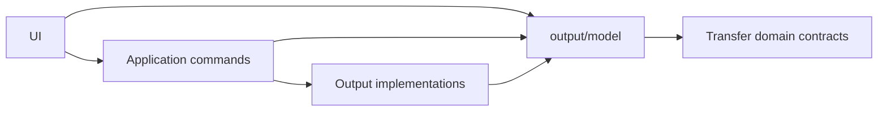

# Web output boundaries

## Purpose and analysis

Give presentation a small, explicit output API for immutable facts and pure queries. Application commands continue to own effects; output implementations continue to own storage, writers, publication, and recovery.

The current presentation policy in `web/scripts/dependency-boundaries/policies.mjs` enumerates 27 forbidden output paths. UI directly depends on seven output modules. These dependencies include both types and executable pure functions, so moving types alone would leave the boundary incomplete.

The weakness is concrete: an in-memory dependency probe adding a UI import of `output/streams/single-file.ts` was accepted, although `SingleFileStreamOutputSession` acquires an output writer. A similar probe accepted `output/browser-storage/persistence.ts`, which requests persistent browser storage. These are demonstrated policy gaps, not existing UI imports or evidence of a broken download flow.

The underlying issue is an implicit public surface. Output models, persistence formats, and execution capabilities share paths without a default restriction on presentation access. The graph resolver already follows indirect dependencies; the presentation policy is what requires developers to remember each implementation path.

A global contracts bucket would obscure ownership. Existing `src/contracts` contains low-level transport contracts and cannot depend on transfer or output. Pure data also does not automatically belong in a public API: checkpoint records and storage policy digests remain implementation details.

## Architecture decision

Introduce `web/src/output/model/` as the output domain's presentation-facing surface. It contains immutable facts and pure queries, organized by domain concept.

All other output paths are outside the presentation-facing API. Application composition and existing diagnostic consumers keep their implementation dependencies. Keep provider files in their purpose-specific directories.

Output models may depend on lower-level domain contracts. They cannot depend back on output implementation modules, application code, presentation, or concrete browser storage and connectivity implementations. Type-only imports obey the same ownership rules.

Application remains responsible for coordinating operations. The public model surface exposes no repositories, writable streams, storage handles, mutation callbacks, or factories for execution objects. Public API objects keep their existing domain distinctions rather than replacing them with generic property bags.

Existing transfer-owned concepts stay in transfer. No new workspace package, compatibility facade, or duplicated set of UI-specific copies is needed.

## Ownership changes

Paths below are relative to `web/src/`.

| Current source | Destination and responsibility |
| --- | --- |
| `output/planning/contracts.ts` | Extract the contract family used by presentation into `output/model/artifacts/`: choices, offers, projections, and their destination facts. Move the complete type dependency closure. Keep planning assembly and execution binding concerns private. |
| `output/planning/naming.ts` | Move `artifactRequestedName` and its pure helper into `output/model/artifact-name.ts`. Other naming and planning operations remain with their owners. |
| `output/workspace/operation-display.ts` | Move display identity and its immutable snapshot functions into `output/model/operation-display.ts`. Display identity continues to carry no output or deletion authority. |
| `output/resume/descriptor.ts` | Move `ReceiveOperationContinuation` into `output/model/continuation.ts`. Descriptor construction and recovery orchestration remain private consumers. |
| `output/browser-delivery/model.ts` | Move `BrowserRecoveryPreference` into `output/model/browser-delivery.ts`. Versioned save policies, checkpoint references, and durable records remain private. |
| `output/browser-delivery/retained.ts` and `recovery/local-actions.ts` | Publish the delivery summary and pure staging/action queries under `output/model/`. Keep record readers, incremental accumulators, live projection state, and action execution with browser delivery. |
| `output/file-system-access/compatible-name/model.ts` | Move the repair-summary snapshot logic, footer snapshot logic, and their pure supporting definitions beside the existing types in `transfer/lifecycle/name-repair.ts`, using a sibling module where appropriate. Ledger formats and persistence codecs remain output-owned. |

Extract definitions rather than re-exporting implementation modules through a new barrel. Public modules must remain independent when their dependencies are followed transitively.

### Delivery summary semantics

The current `BrowserDeliveryResumeSummary` serves both active progress and retained operations, and embeds the entire `BrowserSavePolicyV1`. That ties presentation-facing facts to durable target namespaces and policy records.

Use a shared `BrowserDeliverySummary` for live and retained observations, exposing `operationId`, `receiveIntentDigest`, and the existing file/byte counters. Keep save policies producer-owned and recovery preference a separate user-intent type. Remove the `localContinuation` field and its derivation; derive available local actions through the shared query that checks lifecycle and identity.

Update identity checks in `application/receive/state.ts`, folder-progress production, retained delivery assembly, and the pure local-action query to use those explicit identity fields. Preserve operation-and-intent binding and progress-generation checks.

Produce this summary at the existing projection boundary. Preserve incremental counter updates and bounded record-page processing; presentation must not reconstruct summaries by scanning file history. Stored policy and checkpoint formats retain their existing ownership and meaning.

## Execution sequence

### 1. Extract the public domain definitions

Create the model modules listed above and move each definition with the pure dependencies it actually requires. Preserve discriminated unions, readonly fields, identity semantics, and snapshot behavior.

Split artifact contracts by choices, offers, and destination facts instead of moving the entire planning subsystem into a public module. Update internal producers and planners to import those definitions directly.

Separate pure projection contracts from trace events and sources within `transfer/projection`, and import them directly from `output/model`. Even a direct import of `projection/model.ts` currently reaches relay heartbeat through diagnostic types.

Move compatible-name snapshot behavior into the transfer domain alongside its existing summary types. Share the snapshot rules with ledger code rather than maintaining separate presentation and persistence versions.

### 2. Separate delivery observations from storage records

Introduce `BrowserDeliverySummary` and update the existing summary producers. Keep accumulation, record interpretation, and storage policy ownership inside browser delivery.

Move the pure local-action and staging queries to the public model surface. Update their application and UI consumers together with the identity-field change, including active folder progress and retained-operation assembly. Update existing recovery tests and browser probes for the new summary and shared action query.

### 3. Migrate presentation and application consumers

Replace all seven current UI output dependency targets with the new public model modules or the existing transfer domain, as appropriate. Cover ordinary imports, inline type imports, and executable queries in saving choices, task stages, lifecycle presentation, progress, and transfer-result presentation.

Update application observation contracts and output producers to use the same definitions. Application composition may still import output implementation modules to assemble and own effects. Keep UI commands routed through their current application owners.

Remove displaced definitions and obsolete re-exports as their consumers migrate. Do not preserve old paths solely for compatibility.

### 4. Express public access in the dependency framework

Extend `dependency-boundaries/graph.mjs` with one scoped public-surface rule: a dependency inside a restricted module root is permitted only when it lies within that module's declared public subtree.

Apply it to presentation with restricted root `output` and public subtree `output/model`. Every other output path, including newly added paths, is rejected automatically. This replaces the 27 output-specific forbidden entries.

Continue graph traversal through the permitted model subtree. It is not a traversal stop. Add a model-specific policy that rejects dependencies on output implementation paths, application, UI/React, and concrete platform implementations; this policy has no application or diagnostic traversal exemptions.

Keep `application/browser-receive` forbidden to presentation. Preserve the existing application-command and diagnostic-service traversal stops for the UI policy, with forbidden-path matching taking precedence. Preserve the other transfer, session, and protocol boundaries.

Retain the current TypeScript resolution and dependency-chain reporting. Cover public access, new private paths, and transitive violations in focused graph tests. Keep this framework extension limited to module-root/public-subtree semantics rather than introducing per-symbol privileges or another file inventory.

### 5. Close the migration

Remove unused planning barrels and any temporary forwarding imports left by the migration. Keep provider modules in their existing domain directories and expose public definitions through the designated model paths.

Keep existing runtime trace events with the operations that own them, including operation identity and decision context. The new model layer introduces no runtime service or logging lifecycle.

## Experience and cost

The user-facing benefit is indirect: future output changes become less likely to leak storage execution into presentation. This work does not itself promise faster transfers or fewer clicks.

Keep picker invocation inside the existing synchronous user-action chain. `output/capability/acquisition.ts` deliberately starts the directory picker before a promise continuation; an extra asynchronous dispatch layer would risk breaking ordinary save actions.

Preserve progressive reception, direct and staged output choices, continuation behavior, and the timing of publication and cleanup. Moving module ownership does not require additional prompts, storage copies, or preparation steps.

Developer experience improves through predictable imports and automatic restrictions on newly added implementation modules. The main costs are import migration and the delivery-summary field change. One shared model surface and one scoped graph rule replace the ongoing implementation-path inventory; repeated DTO conversion, per-frame copying, and a global contracts layer would add cost without serving this boundary.
