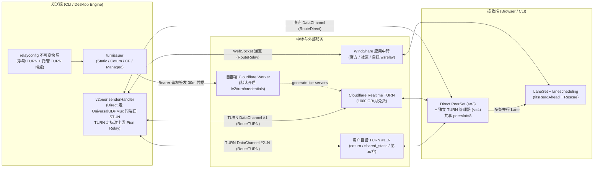
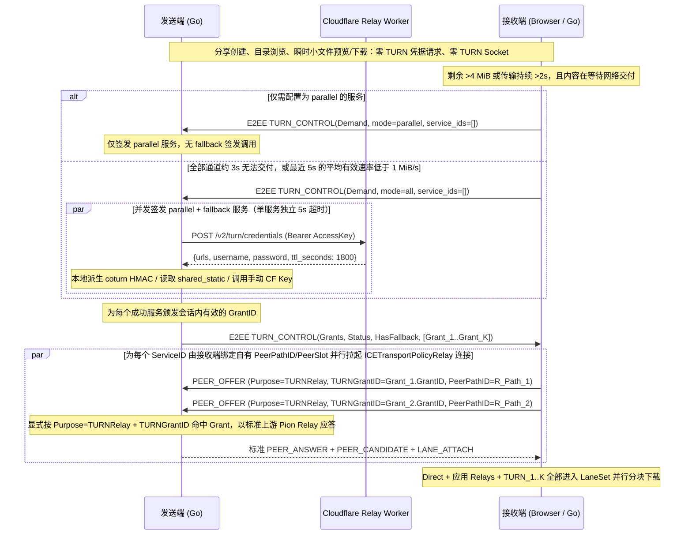

# 轻量化 TURN 并行中继恢复与原生穿透优化计划

## 1. 背景与根因分析

### 1.1 为什么此前移除了旧版 TURN（`f618a717` / `fb09b514`）
此前仓库在 10 月围绕“免费 Cloudflare Workers 个人部署”搭建了一套重型全栈 TURN 编排体系，最终在 `f618a717`（-27,531 行）与 `fb09b514`（-2,591 行）中被彻底拆除。拆除旧版的根本原因**不是“TURN 没有价值”**，而是**旧版实现严重过度工程且侵入全局主路径**：

- **体量与维护税失控**：跨 Go / Rust / TypeScript 累积约 30,000 行代码与测试，包含 9 种 `TURN_CONTROL` 信令、传输中途后台再建连接跑 20s/8 MiB 的 UDP/TCP/TLS443 在线 A/B 压测、先建后断（Make-Before-Break）双端同步容量池、本地用量账本与独立磁盘缓存。
- **拖入 Pion Fork 债务**：为支持自定义 TURN 出口探测与 socket 劫持，专门维护了一份 7,898 行的 `third_party/pion/turn` 副本及 ~900 行 `ice.patch` 补丁，阻碍上游升级。
- **反向约束高频主路径**：`Engine` 持有全局可变 TURN 状态，迫使 Desktop Host 为创建分享引入串行锁；每次会话还会启动无意义的后台定时器。
- **Cloudflare 服务端状态机过重**：`relay-cloudflare` 中 1,314 行生产代码（占该 crate 三分之一）用于维护 SQLite 租约表、7 态 Lease 状态机、DO Alarm 异步吊销重试队列、4 阶段部署握手状态机及 Analytics API 接入，消耗 Free Tier 宝贵的 Durable Object SQLite 写入配额。

### 1.2 为什么需要以轻量化方式恢复并实现并行
站在真实产品场景与用户原始诉求（多通道并发提速、充分利用免费/自有外部资源、免费 Cloudflare 一键自部署可用），彻底砍掉 TURN 存在明确的功能缺口：

1. **第三方/现有 TURN 无法运行 `wsrelay`**：Cloudflare Realtime TURN（1,000 GB/月免费额度）、Metered、ExpressTURN 或用户/组织手头已有的 `coturn` 服务器都只能通过标准 TURN 协议接入。只有保留 TURN 通道，才能把这些外部带宽纳入并发池。
2. **Cloudflare 个人自部署需要兜底**。仓库在 Workers Free 上用单个浏览器接收 32 MiB，测得 `0.201 MiB/s`，包含该次网络路径与浏览器落盘耗时。仅部署 Cloudflare 节点且打洞失败时，托管 TURN 可提供另一条内容通道。见 `relay-rust/crates/relay-cloudflare/tests/capacity-evidence.md`。
3. **多路并行复用现有调度器**。
   - 当主力通道带宽有限时，自有 TURN 或托管 TURN 可利用额外带宽。实际增益取决于各路径是否共享瓶颈。
   - 当存在高速通道（P2P 直连或 100 Mbps 国内 VPS `wsrelay`）时，WindShare 现有的 `LaneSet` + `lanescheduling`（`core/transfer/lanes`、`web/src/content/scheduling/selection.ts`）已内置两道天然保护：
     - **前沿保护**：消费前沿块（`distance == 0`）优先分配给最快通道；
     - **预读准入与尾块抢救**：非前沿块仅在 `fitsReadAhead` 确认慢通道能在被消费前送达时才分发，卡顿时由 `LaneRescues` 自动在快通道竞速补救。
   - 将 TURN 作为标准 `Lane` 加入 `LaneSet`，沿用分块、预读和抢救逻辑。

### 1.3 去 Pion Fork 后遗留的两处原生穿透差异分析（#16 / #17）
在 `83c73c5d` 去除 `third_party/pion/{ice,webrtc}`（净删 53,088 行）回归官方上游 Pion 时，核心的 SCTP RACK 防卡顿与 UPnP/PCP 映射已无损保留，但出现两项行为变化，结合 [产品决策.md](../clarifications/产品决策.md)（提升高频核心体验优先，不为低频牺牲高频，拒绝无谓重型改造）分别取舍如下：

1. **STUN 探测复用已分配宿主端口（#16 — 纳入本计划独立轨道 A，零 Pion Fork 恢复）**：
   - **现状问题**：官方上游 `pion/webrtc` 的 `SettingEngine` 只暴露了 `SetICEUDPMux`（仅用于 host 候选），未暴露 `UDPMuxSrflx`。因此 `pion/ice` 在收集 `srflx` 时会绕开 `socketauthority` 的 64 端口预算，每轮尝试为每个 STUN 服务器另开临时随机 UDP 端口，导致跨重试无法复用既有 NAT 映射，也失去 host/UPnP/STUN 同端口对齐优势。
   - 在 `socketauthority` 使用上游 `ice.NewUniversalUDPMuxDefault` 并禁用映射缓存，由 `pionpeer` 在已分配端口执行 STUN，经候选派发器补发 `srflx`。这样可跨重试复用 NAT 映射，并把 STUN 纳入原有 64 端口预算。
2. **首次 ICE 检查超时 30s vs 39.5s（#17 — 纳入独立轨道 A，反向对齐应用层预算）**：
   - **现状问题**：上游 `pion/ice` 无独立首次检查超时，默认 `disconnectedTimeout(5s) + failedTimeout(25s) = 30s`；而应用层 `connectivity/v2peer/phase.go` 仍沿用旧 fork 时代的 `PeerICECheckingBudget = 40s`，导致上下层超时口径不一致。
   - 保留上游 30s 首次检查窗口，应用层 `PeerICECheckingBudget` 对齐为 `32s`。后续尝试可使用新候选和刚就绪的 UPnP 映射，已建连接的断线检测沿用当前超时。

### 1.4 新旧方案对比（减法边界）

| 维度 | 旧版实现（~30,100 行 TURN + 53k Pion fork） | 本计划轻量化方案（分两轨，目标 ~3,500–5,500 行含测试） | 取舍理由 |
|---|---|---|---|
| **Pion 依赖** | 7,898 行 `pion/turn` fork + 41,310 行 `ice`/`webrtc` fork | **零新增 fork**：直接使用上游 `pion/webrtc/v4` 与 `pion/ice/v4` | TURN 走标准 `ICETransportPolicyRelay`，同端口 STUN 用上游公开 `UniversalUDPMuxDefault` |
| **会话信令与路由判别** | `TURN_CONTROL` 9 种消息 | `Demand` 指定 `parallel` / `all`，`Grants` 返回签发状态、角色提示和凭据 | `Offer` 携带 `TURNRelay` 和 `TURNGrantID`，建连后复用 `LANE_ATTACH` |
| **传输协议选路** | 2,105 行在线 A/B 压测（20s / 8 MiB 对比切换） | 单服务内所有 `turn:` / `turns:` URL 交给标准 ICE | ICE 按候选对优先级选通，多服务可并行传输 |
| **凭据到期** | 先建后断容量池 + 双端同步提交替换 | 常规续期复用原路径与槽位 | 仅在传输中的最后一条已鉴权通道即将到期时，提前建好接替通道 |
| **原生 STUN 与 ICE 超时** | Fork `pion/ice` 注入 `SrflxMux`、`RefreshXORMappedAddr`、`InitialCheckingTimeout=39.5s` | 应用层用官方 `UniversalUDPMuxDefault`（禁 25s 缓存 + 串行派发器）同端口发 STUN 并补发 `srflx`；保留上游 30s ICE 超时，应用预算对齐为 `32s` | 保住高价值的同端口 NAT 映射复用与 64 端口限额，丢弃无实测收益的 9.5s 等待与 fork 债，且作为独立 PR 交付 |
| **Cloudflare 托管服务端** | 1,314 行 DO SQLite 租约表 + Alarm 吊销队列 + 管理台独立 Tab + Analytics | **~280 行无状态 Edge 签发 + 极简开关**：签发路径 DO 只读验权 + 内存限频（0 SQLite 写）+ **30 分钟短 TTL**；管理台通过现有 `capabilities` 展示极简启用开关 | 用短 TTL 替代租约表与异步吊销重试，保留管理员暂停新签发能力（不误伤 `relay-native` 共用管理台），无独立 Tab 或 Analytics |
| **Cloudflare 自动部署** | 4 阶段 DO 状态机 + 管理台登录 RPC 协调 | **~100 行幂等脚本**：默认 `CLOUDFLARE_TURN_ENABLED=true`，已有 `TURN_KEY` 直接复用，无则按确定性名称建 Key 写 Secret | 无状态可重入，日常更新零 Calls 写操作且不断流，权限不足时降级告警不阻塞中转与前端部署 |
| **客户端配置与状态** | `turncache` 独立文件 + `Engine` 全局可变状态（导致 Desktop 串行锁） | `relayconfig` 一等配置字段（含显式 `role`）+ 单次分享不可变快照传入 `ShareRequest` | 无全局锁、无额外磁盘状态文件，CLI 与 Desktop 自动共享 |

---

## 2. 架构设计与核心不变量

### 2.1 端到端并行传输拓扑



### 2.2 按需签发与并行建连时序



### 2.3 核心架构不变量

1. **连接模式语义正交**：
   - `auto`：`RouteDirect` + `RouteRelay` + `RouteTURN` 全允许并可同时并行；
   - `p2p-only`：仅允许 `RouteDirect`，接收端绝不发送 `TURN_CONTROL(Demand)`、绝不接入 `RouteTURN`；
   - `relay-only`：仅允许 `RouteRelay`，零 ICE/WebRTC 连接、零 TURN 活动。
2. **按需角色分层与额度保护（不依赖浏览器私网 IP 猜测）**：
   - `auto` 仅在有网络需求，且满足规模或时长门槛（剩余 `> 4 MiB` 或持续 `> 2s`）时评估新增 TURN。块因网络或退避而排队（`networkWaitingBytes > 0`，即使没有在途块），或在途窗口已满且还有后续内容（`windowHasMoreWork`），都算网络需求。消费或落盘背压不触发。浏览、短下载和首块直接使用已就绪通道。
   - `Demand.Mode` 由角色和当前内容交付情况决定。
     - `parallel` 允许在有网络需求时并行提速，手配 `coturn` / `shared_static` 默认使用此角色。
     - `fallback` 用于托管 TURN，也是手配 `cloudflare` 的默认角色。只有各通道均无法交付内容约 `3s`，或直连、`wsrelay`、已接入 TURN 的最近 `5s` 的合计平均有效速率低于 `1 MiB/s`，才通过可用的已鉴权通道发 `mode=all`。能正常供数的高速 `wsrelay` 足以承担直连失败后的传输。
   - 只有 `Grants.Status=unconfigured` 才停止本会话的 TURN 评估。首次从 `parallel` 升级到 `all` 有独立的重试机会。全量重试要求相应网络需求仍在且有服务名额，定向续期使用该服务的有限退避。`HasFallback` 只表示已知的服务角色。仅有 `fallback` 时收到空的 `ok`，等需求升级再请求。
3. **槽位预算与直连生命周期解耦**：
   - 将 `peerslot.Count`（Go 与 TS 同步）从 `4` 提升至 `8`，与现有 `SenderMaxActivePeerAttemptsPerSession = 8`、`peerset.MaximumPaths = 8`、`MaxLogicalLanes = 16` 对齐。
   - `MaxDirectPaths = 3`（主直连 1 + 吞吐探索 2），常驻 TURN 最多 4 条，另留 1 个协商槽位供接替。Go 与 Web 使用相同上限。
   - **TURN 管理器独立于直连 `PeerRecoverySupervisor` / `peerset.Path` 波次状态机**：仅共享 `peerslot.Pool` 槽位租约与单次协商执行能力；浏览器侧使用独立于直连的并发准入（不占直连 `tab-admission` 的 4 并发上限，不扣 STUN 端点预算）；直连 `PeerSet` 的活跃数/`hasPendingPath`/`hasEligiblePath` 仅统计直连路径；Go 接收端 `auto` 模式下，直连 `Path` 遇 `PeerFailurePathTerminal` / 波次耗尽退出**不得**取消 `ReceiverSession`（仅 `PeerFailureSessionTerminal`、`NoDemand` 或显式关闭才终止会话），确保直连彻底失败后 TURN 仍持续兜底。`ThroughputController` 保持 `UsefulBytes` 与 `OutputBytes` 全局总口径一致（不在 `SchedulingDemand` 拆单独口径，避免 `outputLimited` 背压误判；仅在 TURN 刚建连/断开的短窗口内暂缓新直连探索）。
4. **双端 `ICETransportPolicyRelay` 隔离**：
   - TURN 连接在发送端与接收端均强制使用 `ICETransportPolicyRelay`，且接收端按预期路径严格校验选中候选对（直连路径拒绝 `relay` 候选；TURN 路径接受任一端为 `relay` 且两端候选类型合法的候选对，兼容 trickle-ICE 竞态下常见的 `(relay, prflx)`），确保：
     - 不会退化为直连而造成路由归因失真（避免把直连流量误记为 TURN 或破坏 `p2p-only` 语义）；
     - 在阻断全部 UDP 的企业网中，双端都能经 `turns:`（TLS 443）连通；
     - 发送端完全绕开 `socketauthority` UDP/TCP mux、`SetIPFilter` 与 UPnP/PCP 网关映射，零依赖 Pion fork。
5. **直连同端口 STUN 与超时口径对齐**：
   - Go 两端的直连 STUN 复用 `socketauthority` 宿主端口和 64 端口预算。host、UPnP 候选和 Offer/Answer 即时发送，同端口 STUN 结果可随后补发。
   - 原生 ICE 首次检查保留上游默认 30s 超时，应用层 `PeerICECheckingBudget` 收齐为 `32s` 作为保护壳（浏览器端 `PEER_ICE_CHECK_BUDGET_MILLISECONDS` 刻意保留 40s，使发送端先干净收敛）。
6. **显式信令路由判别，保持 `PeerPathID` 接收端单主权**：
   - `v2signal`（Go + TS + testvectors，升级 `SignalingSchemaVersion = 5`）显式扩展 `ConnectionPurpose = TURNRelay (3)`，并在 `Offer` 携带可选 `TURNGrantID`（`Purpose == TURNRelay` 时必填非零 16 字节，直连时必须为 `null`，让非法状态不可表示）；
   - 常规重连由接收端复用该服务的 `PeerPathID` / `PeerSlot`，递增 `AttemptSequence` 并携带新 `GrantID`。其他已鉴权通道可承载控制消息时，先退旧再重连。
   - 若传输中的 TURN 是最后一条可用的已鉴权通道，在凭据到期前用备用槽位和不同的 `PeerPathID` 建连，新通道完成 `LANE_ATTACH` 后才退旧。接替槽成为当前绑定，槽位复用时沿用该槽的 TURN 路径身份与序号水印。接替失败保留仍可用的旧通道，最后一条通道意外丢失则重建会话，可续传的下载复用已保存进度。
7. **出链零阻塞与单点故障隔离**：
   - 创建分享、生成链接、目录浏览均不等待任何 TURN 探测或凭据签发。
   - 任何单个 TURN 服务签发失败、超时或连接断开，只影响该 `ServiceID` 对应的通道，其他 TURN、应用层中转与直连不受任何影响。
8. **边界纯净**：
   - `core/**` 保持严格无网络依赖（只放 CBOR 编解码、路由枚举与调度逻辑，不引入 HTTP/Pion/osfs）；
   - `engine/**` 不引入 `osfs/**` 或 `adapters/**`；
   - 分享持有不可变 TURN 配置快照，会话持有签发凭据，Engine 只共享原生 TURN 协商额度。

---

## 3. 分阶段执行计划

> **交付分轨**：原生穿透优化（**轨道 A**：阶段 4.1 同端口 STUN + 阶段 4.2 32s 超时对齐）与轻量化 TURN（**轨道 B**：阶段 1–3、4.3–4.6、5–6）彼此正交，拆为独立 PR 分轨交付与验证，避免互相耦合与拖慢评审。

### 阶段 1：核心协议、槽位扩容与路由语义（`core/` + `connectivity/v2signal/` + `web/src/protocol/`）

**目标**：建立极简、显式且跨端确定性的 Go ↔ TypeScript 协议与路由契约，为多路并发打底。

1. **扩容会话协商槽位并显式扩展 `v2signal`**：
   - [core/session/peerslot/slots.go](../../core/session/peerslot/slots.go) 与 [web/src/session/peer-slots/slots.ts](../../web/src/session/peer-slots/slots.ts)：将 `Count` / `PEER_CONTINUATION_SLOTS` 从 `4` 调整为 `8`，同步更新相关槽位边界测试与跨端向量；
   - [connectivity/v2signal/codec.go](../../connectivity/v2signal/codec.go)、[web/src/connectivity/signaling-codec.ts](../../web/src/connectivity/signaling-codec.ts)、[web/src/session/operation-continuation.ts](../../web/src/session/operation-continuation.ts) 与 [web/src/session/message.ts](../../web/src/session/message.ts#L428-L461)：升级 `SignalingSchemaVersion = 5`，在 `ConnectionPurpose` 增加 `TURNRelay = 3`，在 `Offer`（8 元素数组，`Answer` 保持 7 元素）增加可选 `TURNGrantID`（`Purpose == TURNRelay` 时必填非零 16 字节，直连时必须为 `null`）；同步更新 [sender_admission.go](../../connectivity/v2peer/sender_admission.go#L146-L172)（`recoverOfferBinding` 解析 `Purpose`）与 [factory.go](../../connectivity/v2peer/factory.go#L299-L302)（畸形 `TURNRelay` Offer 占位符填充非零 `TURNGrantID`），并更新 `core/testvectors/`。
2. **注册 `MessageTURNControl` 会话级控制消息**：
   - [core/session/protocolsession/message.go](../../core/session/protocolsession/message.go)（及对应 `semantics.go`、`control.go`、`operation.go`、`sessioncore`、`sendersession`/`receiversession`、`web/src/session/`）：恢复 `MessageTURNControl MessageKind = 20`，定义为无 `OperationID` 的会话级控制消息，采用与 `MessagePeerPathControl` 相同的回调注册与发送路径（`SendTURNControl` / `SetTURNControlHandler`），并在 `ValidateSessionControlBody` 显式区分方向（Receiver→Sender 仅允许 `Demand`，Sender→Receiver 仅允许 `Grants`）。
3. **实现极简 `turn_control.go`（直接置于 `core/session/protocolsession/`，对齐 [peer_path_control.go](../../core/session/protocolsession/peer_path_control.go) 避免循环依赖）**：
   - 仅定义 2 种消息体（确定性 CBOR 数组或 `uint64` 键 map——遵守 `validateCBORValue` 禁止字符串 map key 的契约，严格防超长与重复键）：
     - `Demand`（Receiver → Sender）：`[Schema=1, Kind=1, RequestID: uint64, Mode: uint8, ServiceIDs: []string]`。`Mode` 为 `1`（`parallel`：仅签发 `role=parallel` 服务，不触发 `fallback` 托管/计费服务）或 `2`（`all`：签发 `parallel` + `fallback` 服务）；`ServiceIDs` 为空表示按 `Mode` 全量申请，非空（最多 4 个）表示定向刷新过期或断连的指定服务。
     - `Grants`（Sender → Receiver）为 `[Schema=1, Kind=2, RequestID: uint64, Status: uint8, HasFallback: bool, Grants: []Grant]`。`1=ok` 表示本次目标已处理完，包括仅配 `fallback` 时对 `parallel` 的空回复。`2=unconfigured` 仅用于发现已完成且确认没有启用服务。`3=retry_later` 表示无可返回凭据且发现未定，或本次签发全部暂时失败（如超时、429）。`4=partial_retryable` 携带至少一项可用凭据，表示另有本次目标暂时不可用。
     - 单条 `Grant` 为 `[ServiceID: string, GrantID: [16]byte, URLs: []string, Username: string, Password: string, ValidForMS: uint64]`。`ValidForMS` 按发送回复时距签发方到期的剩余毫秒计算，`0` 专用于静态凭据。
   - 严格校验常量：`MaxGrantsPerMessage = 4`、`MaxURLsPerGrant = 8`（对齐 `iceconfig.MaximumURLs`，兼容 Cloudflare 返回 3–5 条 URL）、`MaxURLBytes = 512`、`MaxCredentialBytes = 1024`、`MaxBodyBytes = 16 KiB`；URL 仅允许 `turn:` 与 `turns:` scheme，禁止含空白字符或内嵌凭据。
   - 在 `web/src/protocol/turn-control.ts` 实现对称编解码，并在 `core/testvectors/turn-control.json` 沉淀 Go ↔ TS 共享规范向量。
4. **恢复 `RouteTURN` 路由与观测归因**：
   - [core/transfer/lanes/routes.go](../../core/transfer/lanes/routes.go)、[set.go](../../core/transfer/lanes/set.go#L64)、[measurement.go](../../core/transfer/lanes/measurement.go)、[admission.go](../../core/transfer/lanes/admission.go#L76-L82)、[core/downloadmetrics/metrics.go](../../core/downloadmetrics/metrics.go)：新增 `RouteTURN`（`DiagnosticName() == "turn"`），同步更新 `Set.contentActivity` 定长数组与预分配容量（扩展覆盖 `RouteTURN` 防越界）；`ContentRouteAll` 允许，`ContentRouteDirectOnly` 与 `ContentRouteRelayOnly` 均拒绝；`downloadmetrics` 区分 `Direct` / `ApplicationRelay` / `TURN`（`Snapshot.TURNBytes`）有效字节，不把 TURN 计入 `direct` 可用性；`SchedulingDemand` 保持现有字段不变。
   - 调度成本：在 Go `core/transfer/lanes/admission.go` 与 TS `web/src/content/scheduling/completion.ts` 中，`RouteTURN` 与 `RouteRelay` 统一使用 `RelayCostFactor`（`1.1`），`RouteDirect` 为 `1.0`——同速时直连优先，多条 TURN 与应用中转之间完全按实测完成时间与 `fitsReadAhead` 自然并行。

---

### 阶段 2：Cloudflare 托管 TURN 服务端与默认开启部署（`relay-rust/` + `consoles/relay/` + `scripts/deploy/cloudflare/`）

**目标**：让所有通过 GitHub Actions 部署 Cloudflare（`full` / `relay-only`）的用户**默认自动开启托管 TURN**，同时把服务端复杂度压到旧版的 1/5 且零 SQLite 写入。

1. **Cloudflare Worker 无状态签发端点（`relay-rust/crates/relay-cloudflare/`）**：
   - **能力宣告**：在 [platform/edge.rs](../../relay-rust/crates/relay-cloudflare/src/platform/edge.rs) 的 `GET /.well-known/windshare` 响应中，当 `env.secret("TURN_KEY").is_ok()` 时自动附加布尔能力标记：
     ```json
     "managed_turn": true
     ```
     不暴露任意外部 URL 字段——客户端固定由 `relay_url` 同源拼出 `<relay_url>/v2/turn/credentials`，从契约层面杜绝 `AccessKey` 发往第三方域名；未绑定 `TURN_KEY` 时省略（或为 `false`），与普通 `wsrelay` 保持干净兼容。管理员在管理台暂停托管 TURN 不改变该端点能力宣告（避免重开时老客户端需重新配对），而由签发接口返回明确错误码 `turn_disabled`。
   - **认证与限频**：在 [platform/access/handlers.rs](../../relay-rust/crates/relay-cloudflare/src/platform/access/handlers.rs) 与 [platform/access/mod.rs](../../relay-rust/crates/relay-cloudflare/src/platform/access/mod.rs) 新增内部路由 `POST /internal/authorize-turn`（放行内部调用，且在 `db.cleanup(now)` 与 `self.schedule()` **之前提前返回**）：
     - 先验证摘要对应的凭证已激活且未吊销，沿用 `windshare-relay-access` 的只读鉴权。
     - 再读取托管 TURN 开关 `setting:managed_turn`（默认启用），已授权调用方在暂停时收到 `403 turn_disabled`。
     - 通过 `RefCell` 在内存维护有界（如上限 1,024 条）的每凭证 60 秒窗口计数（如上限 20 次/分钟，best-effort），超限返回 `429` + `Retry-After`；
     - **不落盘 SQLite 租约表、不写 `last_used`、不注册 DO Alarm**，确保 TURN 签发路径消耗 0 行 SQLite 写入。
   - **Edge 侧签发模块（新增 `src/platform/turn.rs`，~180 行）**：
     - 在 `platform/edge.rs` 挂载 `POST /v2/turn/credentials`（位于 `RELAY_URL` 同域，`entry.mjs` 已有 `/v2/` 转发规则，使得 `wind relay onboard` 与 `wind relay add --access-key` 均无需额外 `CONSOLE_ORIGIN` 即可使用）；
     - 解析 `Authorization: Bearer <access_key>` → 计算摘要调用 `AccessObject` `/internal/authorize-turn` → 通过后直接从无状态 Edge Worker 向 `https://rtc.live.cloudflare.com/v1/turn/keys/{key_id}/credentials/generate-ice-servers` 发送 `{"ttl": 1800}`（30 分钟短 TTL，通过 `worker::Delay` / `AbortSignal.timeout` 显式实施 15 秒超时）；
     - 防御性兼容 Cloudflare 响应中 `iceServers` 为对象或数组、凭据字段名为 `credential`，过滤掉 `stun:` URL，校验仅保留合法 `turn:`/`turns:` URL，返回 `{ "urls": [...], "username": "...", "password": "...", "ttl_seconds": 1800 }`（带 `Cache-Control: no-store`）。
   - **管理台极简开关（走统一 `capabilities` 契约）**：不在 `consoles/relay/` 新建独立 Tab、租约列表或 Analytics 面板；在 `relay-cloudflare` 的 `GET /api/session` 响应 `capabilities` 中按 `env.secret("TURN_KEY").is_ok()` 注入 `managed_turn: true`（`relay-native` 不返回该字段，确保共用前端零 404）；仅当 `capabilities.managed_turn === true` 时在现有管理台展示极简的「托管 TURN 开关」（通过 `/api/turn/status` 与 `/api/turn/toggle` 读写单行配置键），并在开关旁明示“1,000 GB/月免费额度、超额按 Cloudflare 费率计费；关闭仅停止新签发（已签发凭据最长 30 分钟失效）”。

2. **Cloudflare 部署脚本默认开启 TURN（`scripts/deploy/cloudflare/` + `.github/workflows/cloudflare-relay.yml`）**：
   - **默认开关**：在 [cloudflare-relay.yml](../../.github/workflows/cloudflare-relay.yml)（在部署步骤透传 `vars.CLOUDFLARE_TURN_ENABLED`）与 `scripts/deploy/cloudflare/configuration.mjs` 新增环境变量 `CLOUDFLARE_TURN_ENABLED`，**未设置时默认为 `true`**（仅作用于 `full` 与 `relay-only` 模式，`frontend` 模式完全不触发）；用户显式设为 `false` 时关闭。
   - **API 客户端扩展**：在 `scripts/deploy/cloudflare/cloudflare.mjs` 补回 5 个 Calls/Secret 方法（`turnKeys`、`createTURNKey`、`deleteTURNKey`、`putSecret`、`deleteSecret`）。
   - 沿用 [run.mjs](../../scripts/deploy/cloudflare/run.mjs#L30-L42) 的 `wrangler deploy --secrets-file` 发布 `OWNER_PASSWORD`。仓库锁定的 Wrangler `4.151.1` 会保留未列出的 Secret，连续部署时验证 `TURN_KEY` 仍在。
   - **无状态幂等编排（新增 `scripts/deploy/cloudflare/turn.mjs`，~80 行）**：
     - 确定性 Key 名称：`windshare-${workerName}-${deploymentId.slice(0, 8)}`（长度受控且唯一归属当前部署）。
     - 在 [run.mjs](../../scripts/deploy/cloudflare/run.mjs) 完成 `deployRelay` 验证后执行（调用 `cloudflare.settings()` 或扩展 `deployRelay` 返回 `settings`，因当前 `deployRelay` 仅返回 `{ state, namespaceId, accessNamespaceId, kind }`）：
       - 若 `CLOUDFLARE_TURN_ENABLED === true`：检查当前 Worker 设置里是否已存在名为 `TURN_KEY` 的 `secret_text` 绑定；**已存在则直接复用并跳过 Calls API 调用**（日常代码更新零 Calls 写操作）；不存在则查询 `turnKeys()`，若发现同名孤儿 Key（上次创建后写 Secret 失败的残留）则先删后建，创建新 Key 后立即 `putSecret('TURN_KEY', JSON.stringify({ key_id, api_token }))`。
       - 若 `CLOUDFLARE_TURN_ENABLED === false`：如存在 `TURN_KEY` secret 则删除之，并清理同名部署归属 Key。
     - **非阻塞降级**：若用户的 `CLOUDFLARE_API_TOKEN` 缺少 `Cloudflare Calls / Edit` 权限、账号尚未开通 Realtime/Calls 服务或 Calls API 临时报错，仅在部署日志与 GitHub Step Summary 输出清晰告警（提示开通/补充权限或设置 `CLOUDFLARE_TURN_ENABLED=false`），**绝不令中转与前端部署失败**。

---

### 阶段 3：配置模型、凭据签发深模块与发送端装配（`engine/` + `cmd/wind/` + `host/desktop/`）

**目标**：同时支持“多条用户自备 TURN 并行”与“Cloudflare 托管 TURN 零配置自动生效”，且不污染 `Engine` 并发模型。

1. **统一配置结构（[engine/relayconfig/config.go](../../engine/relayconfig/config.go) + [engine/relayprofile/profile.go](../../engine/relayprofile/profile.go)）**：
   - `savedRelay` 与 `relayprofile.Candidate` 新增布尔字段 `ManagedTurn bool`（`json:"managed_turn,omitempty"`），在 [engine/relaysetup/](../../engine/relaysetup/) 拉取 `/.well-known/windshare` 完成 `onboard` / `add` 时自动保存；同步更新 [engine/relaysetup/state.go](../../engine/relaysetup/state.go#L26-L36)（`setupIntent` checkpoint 透传）、[engine/relayconfig/selection.go](../../engine/relayconfig/selection.go#L47-L75)（`SelectRelays` 透传 `ManagedTurn`）与 [engine/relayconfig/store.go](../../engine/relayconfig/store.go) 的 `document()` 序列化，确保 Desktop/CLI 的任何常规配置保存与 `ShareIntent` 均无损保留 `ManagedTurn` 与 `TURNServices`。
   - `document` / `Config` 新增 `TURNServices []TURNService`（`json:"turn_services,omitempty"`，配置上限 8 个，单会话按顺序最多激活 4 个），支持显式可选字段 `role`（`"parallel" | "fallback"`；省略时 `coturn`/`shared_static` 默认 `"parallel"`，`cloudflare` 默认 `"fallback"`）：
     ```json
     {
       "profiles": [],
       "turn_services": [
         {
           "id": "home-coturn",
           "kind": "coturn",
           "role": "parallel",
           "urls": ["turn:turn1.example.com:3478?transport=udp", "turns:turn1.example.com:443?transport=tcp"],
           "shared_secret": "your-coturn-secret",
           "ttl_seconds": 3600
         },
         {
           "id": "cf-free",
           "kind": "cloudflare",
           "role": "fallback",
           "key_id": "your-turn-key-id",
           "api_token": "your-turn-api-token"
         },
         {
           "id": "third-party-dedicated",
           "kind": "shared_static",
           "urls": ["turn:relay.provider.example:3478"],
           "username": "windshare-guests",
           "password": "pass"
         }
       ]
     }
     ```
   - 校验规则：唯一 `id`、`kind` 仅允许 `shared_static`/`coturn`/`cloudflare`、`role` 仅允许空/`parallel`/`fallback`、`shared_static`/`coturn` 必填合法 `turn:`/`turns:` URL、`ttl_seconds` 限定合理范围（60s–86400s），避免任何非法组合进入运行期。
2. **新建深模块 `engine/turnissuer/`（<= 6 个生产文件）**：
   - 核心领域类型与端口：
     - `ServiceSpec`（使用明确判别字段或内部接口区分 4 种来源：`Static` / `Coturn` / `CloudflareDirect` / `ManagedRelay`，并携带归一化后的 `Role: Parallel | Fallback`）；
     - `turngrant.Credential`（`ServiceID`、`URLs`、`Username`、`Password`、签发方到期时间 `ExpiresAt`）；
     - `Provider` 接口（供 `connectivity/v2peer` 消费：`Issue(ctx context.Context, mode Mode, serviceIDs []string) IssueResult`，其中 `IssueResult` 含 `Status`、`Outcomes []IssueOutcome` 与 `HasFallback bool`）。
   - 4 种签发器实现（全部接受注入 `http.Client`、`Clock`、`Random`，可完全离线单测）：
     - 优先使用短期凭据。显式配置 `kind=shared_static` 即授权将专用账号发给接收端（`ValidFor=0`）。接收端在分享结束后仍可使用，直到提供方撤销或轮换密码。只在配置时说明一次。
     - `coturn`：零网络按标准 coturn 共享密钥规则生成 `username = "<unix_expiry>:<rand_hex>"`、`password = base64(HMAC-SHA1(shared_secret, username))`；
     - `cloudflare`：POST `https://rtc.live.cloudflare.com/v1/turn/keys/{key_id}/credentials/generate-ice-servers` 获取临时凭据（防御性兼容 `iceServers` 对象/数组及 `credential` 字段；如用户配置了 `urls` 子集则按前缀/精确匹配过滤，否则保留全部非 `stun:` URL）；
     - `managed`：由对应已激活私有中转的 `relay_url` 确定性拼出同源 `POST <relay_url>/v2/turn/credentials`（仅允许 HTTPS 或 loopback，且 `http.Client` 禁用 30x 重定向防止 `Authorization: Bearer <AccessKey>` 外泄）；若服务端返回 `turn_disabled`，在本次分享生命周期内将该托管端点标记为已停用，静默跳过后续请求不反复打扰 `AccessObject`。
   - 对持有 `AccessKey` 且 `ManagedTurn` 未知的私有中转，随分享在后台探测 `/.well-known/windshare`（3s 超时），发现后加入 `fallback`。`parallel` 不等待探测，`all` 可在同一 5s 签发预算内等待。探测超时保留未知状态，下次有需求再试。
   - `Resolver` 按 `Mode` 与 `ServiceIDs` 选取至多 4 个目标并发签发，单服务限时 5s。`parallel` 只访问同角色签发器，`all` 优先涵盖已确认的两种角色，在确有兜底需求时可限时等待能够改变选择的能力探测。部分暂时失败时保留成功凭据并返回 `partial_retryable`。
3. **无锁透传至 CLI 与 Desktop**：
   - [engine/share.go](../../engine/share.go) 的 `ShareRequest` 增加不可变 `TURNServices []relayconfig.TURNService`；托管 TURN 规格在 `StartShare` 阶段根据 `selection.Relays` 匹配 `request.RelayIntent.Candidates()` 提取（通过 `NormalizeRelayEndpoint` 规范化匹配，保持 `relayprofile.Registration` 接口封装不变，且 `--relay` 显式覆盖中转时托管 TURN 天然只跟随被选中的中转，手配 `turn_services` 保持正交生效）。
   - `cmd/wind/internal/cli/share.go` 与 [host/desktop/creation.go](../../host/desktop/creation.go) 透传加载到的 `TURNServices`；
   - `Engine` 本身不保存全局可变 TURN 账户状态，Desktop Host 维持当前无串行锁的并发分享创建模型。

---

### 阶段 4：Go 连接层、原生穿透优化与并行 TURN 通道（`connectivity/`）

**目标**：零 Pion fork 同时完成三件事——① 恢复直连同端口 STUN 探测（#16）；② 对齐首次 ICE 检查超时预算（#17）；③ 接入标准并行 TURN 连接。

1. **零 Fork 恢复直连同端口 STUN 探测（#16 — 独立轨道 A）**：
   - [connectivity/socketauthority/mux.go](../../connectivity/socketauthority/mux.go) & [authority.go](../../connectivity/socketauthority/authority.go)：
     - 将底层 `endpoints` 从 `ice.NewUDPMuxDefault` 切回官方上游 `ice.NewUniversalUDPMuxDefault`（它同样满足 `ice.UDPMux` 接口可直接传给 `settings.SetICEUDPMux`，且自带 `GetXORMappedAddrContext`），并显式设置 **`XORMappedAddrCacheTTL: -time.Nanosecond`** 彻底禁用其默认 25s 缓存（非零不回落默认值，且在 Windows 粗时钟 tick 下恒过期，确保跨重试与 `baseline_test.go` 真实发送新 STUN 探针）；
     - 对外暴露受控方法 `DiscoverXORMappedAddr(ctx context.Context, local netip.AddrPort, server *net.UDPAddr, timeout time.Duration) (netip.AddrPort, error)`，复用该宿主端口发送 STUN Binding 请求并由 `UniversalUDPMuxDefault` 按事务 ID 分流回包（网络变更时随 `generation` 切换新 mux，无需旧 fork 的 `RefreshXORMappedAddr`）。
   - [connectivity/pionpeer/connection.go](../../connectivity/pionpeer/connection.go) & [observation.go](../../connectivity/pionpeer/observation.go)：
     - 直连模式不再将 `request.ICE.DiscoveryURLs()` 放入 `pion.Configuration.ICEServers`（彻底消除 Pion 绕过 64 端口上限开启临时 STUN socket 的行为）；
     - 在 `observation.go` 建立**非阻塞串行候选派发器**：收到每个 UDP `host` 候选后，使用带 `ctx` 的 `net.DefaultResolver.LookupIP` 按地址族解析 `DiscoveryURLs()` 域名（缺省端口补 3478）并发起带 5 秒上限与连接关闭上下文联动的 STUN 探测；与 UPnP 映射按 `(external, local)` 去重（**不跳过 `external == local`**，与上游 Pion 行为一致且保证 `baseline_test.go` loopback 正常收发 `srflx`），补发标准 `typ srflx raddr <localIP> rport <localPort>` 候选（`IsMappedCandidate` 仅匹配 UPnP，`origin` 记为 `"ordinary"`；注意合成候选不在 Pion 内部 `localCandidates` 中，本地 `SelectedPair().LocalType` 仍为 `"host"`）；
      - `v2peer` 实际发出的直连 Offer/Answer SDP 在同端口 STUN 仍可补发候选时须省略 `a=end-of-candidates`。派发器在最后一个候选之后转发 `nil`。关闭连接或替换回调时取消在途探测，Pion 回调始终立即返回。
2. **对齐首次 ICE 检查超时预算（#17 — 独立轨道 A）**：
   - 保留上游 `pion/ice` 默认 `disconnectedTimeout(5s) + failedTimeout(25s) = 30s`，不修改 `SetICETimeouts` 也不重新 fork Pion；
   - [connectivity/v2peer/phase.go](../../connectivity/v2peer/phase.go#L17)：将 `PeerICECheckingBudget` 从 `40 * time.Second` 收敛为 `32 * time.Second`（略高于上游 30s 作为外层安全兜底，浏览器端 [contract.ts](../../web/src/connectivity/peer-set/contract.ts#L32) 的 40s 刻意保留使发送端先干净收敛，注释说明关系），同步更新依赖原 40s 数值的阶段超时单测。
3. **强类型 ICE 配置分离（[connectivity/iceconfig/config.go](../../connectivity/iceconfig/config.go)）**：
   - 将 `Connection` 演进为互斥值对象，区分：
     - `NewDirect(discoveryURLs []string)`（仅 `stun:`，用于直连与同端口 STUN）；
     - `NewTURNRelay(urls []string, username, password string)`（仅 `turn:`/`turns:`，必填非空凭据，`ICETransportPolicyRelay`）。
   - 防止 STUN 与 TURN 凭据在类型层面混用。
4. **标准上游 Pion TURN 连接构造（新增 `connectivity/pionpeer/turn.go`，~100 行）**：
   - 新增 `NewTURNPeerConnection(base pion.Configuration, config TURNAttemptConfig) (*TURNConnection, error)`：
     - 使用独立 `pion.SettingEngine`（**不设置** `SetICEUDPMux`、`SetICETCPMux`、`SetIPFilter`，由上游 `pion/ice` 与 `pion/turn` 直接走系统路由建立 UDP/TCP/TLS TURN 分配）；
     - 设置 `configuration.ICEServers = []pion.ICEServer{{URLs, Username, Credential, CredentialType: pion.ICECredentialTypePassword}}` 与 `configuration.ICETransportPolicy = pion.ICETransportPolicyRelay`；
     - 挂载 `OnICEConnectionStateChange`、`OnConnectionStateChange`、`OnSelectedCandidatePairChange` 观测回调，并实现与 `Connection` 一致的 `OnICEConnectionStateChange` 与 `SelectedPair()` 接口，保证阶段超时、路由校验与 `Close()` 幂等释放所有 TURN socket。
   - **不修改 `third_party/pion/`**，仅继续保留已有的 `sctp` RACK 补丁。
5. **发送端接入（`connectivity/v2peer/`）**：
   - 在 `v2peer.Config` 注入 `TURNProvider`。由 `engine/internal/nativeconnectivity.Capacity` 给原生收发两端注入同一 Engine 级 TURN 协商并发额度，跨分享、任务与工厂共享。额度仅覆盖建连至 `LANE_ATTACH`，失败或取消即释放，直连和 STUN 沿用各自预算。
   - 在 [sender_lifecycle.go](../../connectivity/v2peer/sender_lifecycle.go) 的 `runSessionControls` 中同步注册 `SetTURNControlHandler`：
      - 合并同会话同模式的重复全量请求，对定向刷新限频。全量请求复用距到期仍有协商余量的授权，定向刷新异步调用 `TURNProvider.Issue` 换新。为新签发项分配随机 16 字节 `GrantID`，在会话内限量缓存。已受理的 Offer 持有本次授权直到签发方到期，排队期间的轮换不撤销该授权。`Grants` 回传签发状态和 `HasFallback`，无配置且无待发现端点时直接回复 `unconfigured`。
   - 在 `startAttempt` / `attempt.go` / [sender_admission.go](../../connectivity/v2peer/sender_admission.go#L314-L324) 中：
     - 收到 `PEER_OFFER` 时，显式按 `offer.Binding.Purpose == v2signal.TURNRelay` 分流：命中有效 `offer.TURNGrantID` 时直接调用 `pionpeer.NewTURNPeerConnection` 创建应答端连接（不走 `nativepeer.PrepareAttempt`，不消耗直连 socket 租约与 UPnP 映射；未命中/过期时以 `PeerOperationCodeNegotiation` 拒绝对方以便接收端定向刷新重试）；非 `TURNRelay` 恒走直连路径；
     - 通道打开后走完全相同的 `LANE_ATTACH` 鉴权与 `FrameChannel` 交接流程；`acceptAdmission` 对 `TURNRelay` 跳过 `factory.native.SetAdmitted` 并将观测路由记录为 `transferlanes.RouteTURN`。
6. **Go 接收端并行管理与路径归因（`connectivity/v2peer/` + `engine/internal/receive/`）**：
   - [connectivity/v2peer/receiver_admission.go](../../connectivity/v2peer/receiver_admission.go#L23-L47)：扩展 `selectedPeerRoute` 按预期路由校验——直连连接遇到 `ICECandidateTypeRelay` 仍返回 `ErrNegotiation`，TURN 连接则接受任一端为 `ICECandidateTypeRelay` 的候选对并返回 `transferlanes.RouteTURN`；`ReceiverFactory` 补充 `StartTURNBinding` 供 TURN 尝试构造 `NewTURNPeerConnection` 并在 `Offer` 中携带 `TURNGrantID`。
   - [peerset/throughput.go](../../connectivity/v2peer/peerset/throughput.go)：将直连探索上限从 `peerslot.Count - 1` 改为显式常量 `MaxDirectPaths = 3`，`throughputPaths` 仅管理直连路径，保持 `ThroughputController` 现有的总口径（`UsefulBytes` + `OutputBytes`）；**修复 `pathFinished()`**：在 `auto` 模式下，直连路径遇 `PeerFailurePathTerminal` 或波次耗尽退出时不得调用 `s.cancel()` 终止 `ReceiverSession`（仅 `PeerFailureSessionTerminal`、`NoDemand` 或显式关闭才终止），保证直连彻底失败后 TURN 继续工作。
   - 新增独立管理器 `peerset/turn.go`（~180 行，挂载于 `ReceiverSession`，**不塞进直连 `peerset.Path` 波次状态机**）：
     - 仅共享会话级 `peerslot.Pool` 槽位租约与 `v2peer.ReceiverFactory` 单次 TURN 协商（创建 `RouteTURN` 连接并在 `LaneSet` 注册为 `RouteTURN`，不消耗直连 `peerset.Budget` 与 `PeerPathControl`）；
      - `ContentRouteAll` 按 §2.3 的内容需求、合计有效速率和签发状态驱动 `Demand`。
      - 对最多 4 个服务并行发出 `PEER_OFFER{Purpose=TURNRelay, TURNGrantID}`。定向刷新仅请求受影响的 `ServiceID`，沿用 2s / 10s / 30s 有限退避。按 §2.3 的最后通道规则选择续期顺序，`NoDemand` 或会话结束时回收。
   - [engine/internal/receive/peer.go](../../engine/internal/receive/peer.go#L155-L208)：在 `auto` 模式启用 TURN、`p2p-only`/`relay-only` 禁用 TURN；同步更新 `receiverContentPaths.observeContent` 识别 `RouteTURN`，避免纯 TURN 传输时 CLI 路径状态与回退观测失明。

---

### 阶段 5：浏览器接收端并行 TURN 与通道展示（`web/src/`）

**目标**：浏览器打开分享链接预览大视频或下载大文件时，按需并行接入发送端配置的 TURN（含 Cloudflare 托管 TURN）+ 直连 + 应用中转，并在界面准确展示通道类型。

1. **协议与槽位对齐**：
   - `web/src/protocol/turn-control.ts`：实现与 Go 完全一致的 `Demand`（含 `mode`）/ `Grants`（含 `status`、`hasFallback`、`grantId`）确定性 CBOR 编解码；
   - `web/src/session/`：在 `ReceiverSessionRuntime` 增加 `sendTURNControl` 与 `setTURNControlHandler`（对应 `MessageKind = 20`），同步更新 [message.ts](../../web/src/session/message.ts)（`validatePeerAnswer`/`validatePeerCandidate` 升至 v5 + `validateSenderControlBody` 校验 `Grants`）与 [diagnostics.ts](../../web/src/session/diagnostics.ts)（`route` 联合类型补 `'turn'`、`protocolMessageKindV1` 补 `turn_control`）；
   - `web/src/session/peer-slots/slots.ts`：`PEER_CONTINUATION_SLOTS = 8`，同步升级 `signaling-codec.ts` 与 `operation-continuation.ts` 至 `SIGNALING_SCHEMA_VERSION = 5`（支持 `purpose: 'turn-relay'` 与 `Offer.turnGrantId`）；`SessionSignalingRoute` 支持传入可选 `turnGrantId`。
2. **路由策略、候选对归因与调度集成**：
   - [web/src/content/route-policy.ts](../../web/src/content/route-policy.ts)：`BlockTransportRoute = 'application-relay' | 'direct' | 'turn'`；
   - [web/src/connectivity/peer-channel.ts](../../web/src/connectivity/peer-channel.ts)、[peer-route/route.ts](../../web/src/connectivity/peer-route/route.ts#L78-L81)、[peer-set/provider-facts.ts](../../web/src/connectivity/peer-set/provider-facts.ts#L48-L50)：扩展 `PeerPathRoute = 'direct' | 'turn' | undefined`，`knownCandidateType` 与 `classifyPair` 识别 `'relay'` 候选并在两端类型合法且任一端为 `'relay'` 时归类为 `'turn'`（兼容 `(relay, prflx)`，同时在 `OfferNegotiation` 按预期路由校验后再 publish，保持直连严格拒绝 `'turn'`、TURN 严格拒绝 `'direct'`）；
   - [web/src/connectivity/receiver-policy.ts](../../web/src/connectivity/receiver-policy.ts) 与 [peer-set/peer-set.ts](../../web/src/connectivity/peer-set/peer-set.ts#L10)：`ConnectivityRouteAuthority.allows(route)` 在 `auto` 允许三者、`relay-only` 仅允许 `'application-relay'`、`p2p-only` 仅允许 `'direct'`；将 `MAXIMUM_THROUGHPUT_PATHS` 从 `PEER_CONTINUATION_SLOTS - 1` 改为显式直连上限常量（`3`），保持 `ThroughputController` 原有总口径；将 `PeerSet` 私有的 `#slots`（`PeerSlotPool`）上提到 `ReceiverConnectivity` 供直连与 TURN 共享；
   - `web/src/content/scheduling/completion.ts`：`'turn'` 使用 `RELAY_COST_FACTOR`；
   - [web/src/content/broker.ts](../../web/src/content/broker.ts#L14) 与 `web/src/receiver/download-metrics.ts`：补回 `'turn'` 路由与 `turn_bytes` 有效字节统计。
3. **浏览器 TURN 连接工厂（[web/src/connectivity/peer-offer.ts](../../web/src/connectivity/peer-offer.ts)）**：
   - 扩展 `OfferChannelFactory.offer()` 可选参数，支持传入 `turnServer?: { readonly urls: readonly string[]; readonly username: string; readonly credential: string }`；
   - 当传入 `turnServer` 时，构造 `RTCConfiguration = { iceServers: [{ urls: [...turnServer.urls], username: turnServer.username, credential: turnServer.credential }], iceTransportPolicy: 'relay' }`，复用现有 `OfferNegotiation`、`BrowserPeerConnections`、`BrowserPeerRoute` 与 `WebRTCFrameChannel` 全部逻辑。
4. **独立并行 TURN 通道管理器（新增 `web/src/connectivity/turn-paths.ts`，~200 行）**：
   - 由 `ReceiverConnectivity` 持有，**独立于直连 `#peers`（`PeerSet` / `PeerRecoverySupervisor`）**，仅共享 `PeerSlotPool` 槽位租约与单次协商执行能力；在 [tab-admission.ts](../../web/src/connectivity/peer-set/tab-admission.ts) 中使用独立于直连的并发准入（不占直连 4 并发上限，不扣 STUN 端点预算），防止 4 条并行 TURN 阻塞或拖慢直连；
   - 浏览器支持 `RTCPeerConnection` 且 `policy === 'auto'` 时，按 §2.3 的需求、时窗与 `Grants.Status` 决定是否请求 TURN。
   - 最多并行连接 4 个服务。Offer 携带 `purpose: 'turn-relay'` 和 `turnGrantId`，确认路由为 `'turn'` 后注册进 `LaneSet`。定向刷新、最后通道续期和有界退避与 Go 一致，内容需求结束或会话关闭即回收。
5. **接收端通道展示同步（[DownloadChannels.tsx](../../web/src/ui/connection/DownloadChannels.tsx) + 中英文文案）**：
   - 为 `ROUTE_LABEL` 与 `web/src/ui/locales/{en,zh-CN}/connection.ts` 补齐 `'turn'` 通道标签（如 `TURN 中转` / `TURN relay`），避免新增路由后出现类型错误或通道展示空白。

---

### 阶段 6：可观测性、文档更新与验证策略

1. **结构化 Trace 日志（全程严禁泄露任何秘钥/密码/Token）**：
   - 发送端（`engine/turnissuer`、`v2peer`、`pionpeer`）：`turn_capability_discovered`、`turn_demand_received`、`turn_grant_issued`、`turn_grant_failed`、`turn_managed_disabled`、`stun_host_port_discovered` / `stun_host_port_failed`（携带 `session_id`、`service_id`、`kind`、`role`、`grant_id`、`peer_path_id`、`url_count`、`ttl_ms`、`reason`）。
   - 接收端（Go `peerset` / Web `connectivityTrace`）：`turn_demand_sent`、`turn_grants_received`、`turn_path_admitted`、`turn_path_closed`、`turn_refresh_requested`（携带 `session_id`、`service_id`、`status`、`grant_id`、`peer_path_id`、`lane_id`、`lane_epoch`、`reason`）。
   - Cloudflare 侧（`relay-cloudflare` / `scripts/deploy/cloudflare`）：`turn_credentials_issued`、`turn_credentials_refused`、`turn_provisioning_ready`、`turn_provisioning_reused`、`turn_provisioning_skipped`。
2. **精简文档同步**：
   - [docs/cli.md](../cli.md)：更新 `auto` 连接模式说明，并补充 `config.json` 中 `turn_services`的 `role` 示例，并说明 `shared_static` 专用账号的复用期限。
   - [docs/protocol.md](../protocol.md)：更新 `v2signal` v5（`TURNRelay` / `TURNGrantID`）与 `peerslot` 容量，并在会话消息表中补充 `TURN_CONTROL`（kind 20：`Demand` / `Grants`）。
   - [docs/deploy/cloudflare-relay.md](../deploy/cloudflare-relay.md) 与 [docs/deploy/cloudflare-api-token.zh-CN.md](../deploy/cloudflare-api-token.zh-CN.md)：在顶部醒目说明默认开启托管 TURN、1,000 GB/月免费额度与超额计费规则、所需 `Account / Cloudflare Calls / Edit` 权限、管理台暂停开关语义以及通过 `CLOUDFLARE_TURN_ENABLED=false` 关闭的方法。
   - [docs/plans/global-service/global-network.md](global-service/global-network.md)：移除对旧版 9 消息 `TURN_CONTROL` 和 DO 租约模型的过时引用，保持与当前轻量化设计一致。
3. **测试与真实环境验证策略**（控制本地单测耗时，不新增脆弱 UI 测试）：
   - **纯函数与契约**。共享 Go/TS 向量覆盖 `TURN_CONTROL` 方向、CBOR 和四种状态，以及 `v2signal` v5。签发器用假时钟与 HTTP 替身覆盖四种来源、`parallel` 零兜底调用、发现未定、全数暂时失败、部分成功、拒绝重定向与 `turn_disabled`。原生覆盖跨任务协商限额及释放、直连 `PathTerminal` 和 32s 预算。保留 Worker/Miniflare 的鉴权、开关、429、能力宣告与零写入测试，以及部署脚本的建 Key、复用、回收、关闭和缺权限用例。
   - **同端口 STUN（轨道 A）**。在 [connectivity/pionpeer/baseline_test.go](../../connectivity/pionpeer/baseline_test.go) 验证两轮探测均从已分配端口实际发包，守住 64 端口预算。在生产信令测试中延迟 STUN 回包，先收到实际 Go Offer/Answer 并确认均无 `a=end-of-candidates`，再放行回包并验证远端收到 `srflx`。覆盖超时、取消和回调替换时的顺序与清理。
   - **本地多路并行集成测试（轨道 B）**：使用 [go.mod](../../go.mod) 已有的上游 `github.com/pion/turn/v5` 仅在测试进程内拉起 2 个本地 TURN 服务器 + 1 个本地 `wsrelay`，分别覆盖 Go↔Go 与 Go↔Chromium：
     - 验证 2 条 TURN + 1 条 `wsrelay` 真正并行分块下载且最终文件 SHA-256 一致；
     - 覆盖直连失败但 `wsrelay` 高速供数、纯消费背压、慢通道占满窗口，以及零在途块且网络退避。前两项保持 `fallback` 空闲，后两项达到 §2.3 的兜底条件时启用。
     - 验证有其他已鉴权通道时复用原路径与槽位重连，最后一条 TURN 临期时在新通道鉴权后退旧，最后通道意外断开时可续传下载从已保存进度恢复。
     - 验证 `p2p-only` 绝不触发 TURN、`relay-only` 零 ICE 连接；
     - 验证关闭会话后原生 Pion TURN socket 归零、无 goroutine 泄漏。
   - **真实 Cloudflare 环境冒烟验证**：利用已登录的 `wrangler` 与 Cloudflare 账号在隔离 Worker 上验证 `full` 模式默认自动建 Key 并开启 TURN、验证二次常规部署保留既有 `TURN_KEY` Secret（不触发删建循环）、确认 Calls API 的账号前置条件并在文档如实说明、验证管理台开关暂停/恢复与 `turn_disabled` 行为、原生客户端配对后自动发现 `managed_turn`、与真实浏览器完成并行下载并清理测试资源。

---

## 4. 风险点与实施纪律

- **同端口 STUN 派发顺序与关闭安全**：`UniversalUDPMuxDefault` 必须以 `-time.Nanosecond` 彻底禁用 25s 缓存；串行候选派发器等待同端口 STUN 探测时必须受单次 5 秒超时与连接关闭信号双重约束，绝不能阻塞 Pion 原生回调线程或导致关闭卡死。
- **上游 Pion TURN 资源清理**：因 `ICETransportPolicyRelay` 绕开了 `socketauthority` UDP mux，必须确保 `TURNConnection.Close()` 在超时、取消、网络切换与正常结束等全部路径下被无条件调用，并通过连接数/goroutine 回归测试守住不泄漏。
- **Cloudflare Secret 保全与费用透明**：上线前必须在真实隔离 Worker 上验证二次部署不清除既有 `TURN_KEY` Secret；在管理台开关旁与 Cloudflare 部署文档顶部简明提示 Realtime TURN 免费额度为 1,000 GB/账号/月（与 Realtime SFU 共享）、超额按官方费率计费、暂停开关仅停止新签发（已签发凭据最长 30 分钟失效）以及实测确认的 Calls API 账号开通前提；不希望启用时可在管理台一键暂停或设置 `CLOUDFLARE_TURN_ENABLED=false` 彻底移除。
- **模块体量与门禁**：保持所有新增包文件数远低于 20 文件上限，单文件遵守 `make sloc` 限制；每个阶段完成后通过 `make vectors`、`make rust`、`make web`、`make sloc` 及对应 Go 测试收口。
