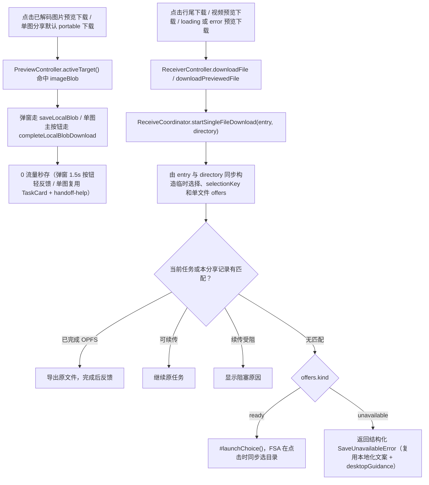

# Web 接收端单文件快捷下载与媒体预览连看连下执行计划

## 1. 背景与根因分析

### 1.1 现状问题
在文件夹 / 多文件分享的 Web 列表（[Explorer.tsx](../../web/src/ui/share-content/Explorer.tsx#L88-L113)）中，单文件获取存在明显摩擦：
- **默认浏览模式（`scope`）**：文件夹行点击进入子目录，可预览图片/视频行点击打开 [MediaPreview.tsx](../../web/src/ui/share-content/MediaPreview.tsx#L15-L39) 弹窗，其余所有文件（PDF、ZIP、文档、大图片等）为静态 `
` 且右侧空白，点击无任何反馈。
- **预览弹窗缺下载与切图**：[MediaPreview.tsx](../../web/src/ui/share-content/MediaPreview.tsx#L22-L38) 弹窗内既没有「下载」按钮（哪怕预览失败时页面文案已经提示“你仍然可以下载原文件”），也没有「上一张 / 下一张」切换。用户浏览相册挑图保存需要反复 `点图 → 关窗 → 点选择项目 → 瞄准 17px 复选框 → 顶部下载`。
- **选择模式（`selection`）存在点击死区**：切入「选择项目」模式后，非预览文件的行主体依然是静态 `
`，用户必须精准点击左侧小复选框才能勾选。

### 1.2 为什么现在适合彻底解决（底层前提分析）
此前担忧“给列表加单文件下载需要动大手术”是基于旧版异步预计算管线（`SelectionProjectionRuntime` / `AuthorityActivationCoordinator`）。而**当前代码已完成核心重构**，带来了三个关键红利：

1. **规划单文件方案已变为 100% 同步纯函数**：
   - [ReceiveCoordinator](../../web/src/application/receive/coordinator.ts#L78-L307) 在加载分享时即缓存了浏览器能力 `#capabilities`。
   - 当前页 [BrowsePage](../../web/src/application/browser-share/gateway.ts#L55-L62) 已持有经过鉴权的文件 `CatalogEntry`（含 `id`、`name`、`expectedSize`）与目录 `path` / `ancestry`。
   - 单文件 ≤16 MiB 优先 `portable`，更大文件优先 `opfs`。OPFS 不可用或配额不足时，≤64 MiB 仍可走 `portable`。两者均不可用时回落到可用的 `fsa`，在点击时同步打开目录选择器。[planArtifactOffers](../../web/src/output/backends/contract.ts#L87-L147)
2. **单任务并发限制与产物标识已就绪**：
   - [canStartNewDownload](../../web/src/application/receive/admission.ts#L108-L110) 与 [isActiveReceiveState](../../web/src/transfer/state.ts#L174-L176) 仅在 `preparing` / `downloading` 期间阻塞新任务。小文件下载完成后无需额外确认，立刻即可点击下载下一个文件。
   - [ResolvedArtifactSpec](../../web/src/transfer/selection.ts#L24-L36) 已原生携带 `singleFileId`，可直接统一派生当前正在下载的单文件标识（同时覆盖列表快捷下载、`paused` 续传与选择单文件下载）。
3. **图片预览已完成 100% 原图传输**：
   - [FilePreview.#initializeImage](../../web/src/preview/preview.ts#L253-L279) 拉取并校验的是完整原图字节（`byteRange(0n, exactSize)`）构成的 `Blob`。预览弹窗点「下载」（以及单图分享自动预览完成后的默认 `portable` 下载）可直接同步保存内存中的原图 `Blob`——**0 额外流量、0 等待、不占用 `TransferJob` 通道**，即使后台正在下载其他大文件也能随时秒存。

---

## 2. 产品决策与边界权衡

### 2.1 核心定位
- **主路径不变**：批量多文件 / 整目录依然以「一次选好 → 顶部统一保存（直写文件夹或单 ZIP）」为主，视觉重心不被列表行图标抢走。
- **高频辅路径一步直达**：「文件夹里随手拿单个文件」和「一张张预览图、挑中即存、继续看下一张」降低至 1 步。

### 2.2 明确做什么
1. **所有文件行提供显式「下载」按钮并治理 `TaskCard` 布局挤压**：
   - 默认模式下显示行尾下载按钮，不改变点击行主体本身的安全浏览语义（文件夹=进入，可预览文件=预览，非预览文件主体不触发下载），并为当前活跃单文件行提供局部“下载中”态反馈；
   - 放宽移动端任务卡下方的列表高度限制。已交付的卡片可收起，OPFS 副本仍可从「下载记录」再次保存。`ready-to-save` 保留「保存」入口。
2. **预览弹窗补齐「下载」与「上一张 / 下一张」及完整状态闭环**：
   - **已解码图片（`image`）**可直接保存原图 `Blob`。弹窗给出短暂的「已开始下载」提示，切图即重置，允许再次保存。单图分享默认 `portable` 保存进入 `download-started (retained: false)`，沿用 `TaskCard` 与 `handoff-help`。「从发送方重新下载」始终发起传输。
   - **视频（`video`）**下载时保持弹窗打开，底栏显示正在下载的文件名与进度。暂停、需操作、待保存或失败时，保留一行原因和可用操作。用户可以继续切图、保存其他照片。
   - **加载中（`loading`）或预览失败（`error`）**时走单文件下载。活跃任务首次发布后，若仍在同一文件的加载或失败态，再关闭弹窗。取消选框时保留预览，启动失败时在弹窗内显示一次错误。
   - 当前页存在 ≥2 个可预览项时，提供「上一张 / 下一张」按钮与键盘 `←` / `→` 切换。
3. **底层增加不修改 `joined.selection` 草稿的单文件接收入口**：
   - 与顶部保存共用后端决策和任务生命周期。快捷下载优先导出本分享已有的 OPFS 副本，其次续传同文件的暂停任务。无法续传或保存时显示原因。
   - 将浏览器能力探测状态显式建模为 `probing | ready | failed`，避免罕见探测失败后列表下载按钮永久卡在“正在准备下载选项…”。
4. **选择模式消除死区、避免双焦点且不断挑图链**：
   - 切入「选择项目」模式后隐藏行级下载图标与行内 `预览` 文案，**文件行**用单一 `<button role="checkbox" aria-checked={...}>` 横跨勾选框列与行主体直接切换勾选（消除复选框与行主体间的点击死区与重复 Tab 焦点；文件夹行保持左侧独立勾选框 + 主体进入子目录），可预览文件复用行尾操作槽提供轻量 `👁` 预览按钮，避免无缩略图时盲选。

### 2.3 明确不做什么（及原因）
- **不做“点击非预览文件整行直接下载”**：同一列表点击整行出现浏览/预览/立刻写盘三种迥异动词，移动端极易滑动误触，违背最小惊讶原则。
- **不做下载队列与多任务并发**：
  - 并发会打破全链路单活跃任务模型（[ReceiveCoordinator](../../web/src/application/receive/coordinator.ts)、`TaskCard`、锁与离开保护），而单任务内本已支持多连接并发拉满带宽；
  - 后台顺序排队在浏览器里会触发三重硬限制：离开用户点击手势后移动端/Safari 可能静默拦截 `<a download>`、Chrome 连续自动下载触发“允许下载多个文件”权限拦截、FSA 选文件夹无法异步拉起；同时还要新增队列 UI 与前序失败/刷新清理状态机。
  - 在「图片预览秒存绕过传输通道 + 小文件下完即释放 + 批量走选择模式」的组合下，单活跃任务模型已能干净覆盖高频场景。
- **本次不调整全局 `planSingleFileOffers` 的 OPFS/FSA 优先级策略**（单文件快捷下载与顶部单文件保存保持行为一致，避免扩大改动面）。

---

## 3. 架构与交互设计

### 3.1 列表行语义矩阵

| 条目类型 | 默认模式（`scope`） | 选择模式（`selection`） |
|---|---|---|
| **文件夹** | 点主体：进入子目录（右侧提示 `打开 >`）；行尾留空占位保列对齐 | 左侧复选框：勾选整目录；点主体：进入子目录 |
| **可预览文件** | 点主体：打开预览弹窗（右侧提示 `预览`）；行尾独立图标按钮：下载该文件 | 单一 `<button role="checkbox">` 横跨勾选框与主体：切换勾选（隐藏行内 `预览` 文案）；行尾槽切换为轻量 `👁` 预览按钮 |
| **非预览文件** | 主体静态展示，无破坏性点击；行尾独立图标按钮：下载该文件 | 单一 `<button role="checkbox">` 横跨勾选框与主体：切换勾选；隐藏行尾按钮 |

- **传输中与阻塞状态**：
  - `activeSingleFileId` 统一从当前活跃 `#activation` 或活跃 `TransferJob` 的 `artifact.singleFileId` 派生；命中行（`activeSingleFileId === row.id`）在行尾呈现轻量“下载中”态，避免移动端滚屏后满屏无差别置灰；
  - `startAdmission` 阻塞时用 `presentReceiveReason` 说明原因，能力探测中显示 `saving.preparingOptions`，探测失败可点按重试。本分享记录预读期间，仅需同步选目录的快捷入口显示准备中。原因写入 `title` / `aria-label`。[presentReceiveReason](../../web/src/ui/experience/receive-reason.ts)
- **网格视图与移动端**：
  - 网格视图将下载图标定位于卡片**右上角**（桌面悬停/聚焦凸显，触屏 `@media (hover: none)` / `pointer: coarse` 常显并保证触控热区）；将现有 `.entry-action-indicator` 移至卡片**左上角**（仅非选择态桌面 hover 显示；网格选择态下隐藏所有 `.entry-action-indicator` 含文件夹角标，或让文件夹角标留在右上角，避免与左上角复选框重叠）；
  - 列表视图拆出独立右侧操作槽，避免 `<button>` 嵌套；窄屏移动端（`max-width: 650px`）隐藏列表行内的 `预览` 文字标签，防止同时挤压长文件名，并同步更新 `@container receiver-contents (max-width: 20rem)` 的列轨道。

### 3.2 单文件下载与预览秒存数据流

---

## 4. 分模块执行步骤

### Step 1：单文件同步规划、任务启动与本地 Blob 保存
- **[single-file.ts](../../web/src/application/receive/single-file.ts)**（新增；[coordinator.ts](../../web/src/application/receive/coordinator.ts) 当前已有 678/700 SLOC，需把单文件规划/匹配彻底下沉并视需要拆分激活/offer 辅助逻辑，确保 `make sloc` 留足余量）
  - 封装单文件临时 `SelectionPolicy(false)` / `SelectionSpec` / `selectionKey` 构造、`snapshotCatalogPath([...directory.path, entry.name])` 校验、同步 `planArtifactOffers` 规划、纯函数化的本地保留任务复用判定（忽略无效终态，按「已完成可导出 > `paused`」及 `createdAtMilliseconds` 降序择优，输出 `export` / `resume` / `blocked(reason)` / `none`），以及结构化 `SaveUnavailableError`（携带 `'storage-full' | 'portable-limit-exceeded' | 'no-safe-destination'`）。
- **[contracts.ts](../../web/src/application/receive/contracts.ts)** & **[output.ts](../../web/src/ui/output.ts)**
  - 新增 `type BrowserCapabilitiesState = 'probing' | 'ready' | 'failed'`，以及显式单文件启动结果类型 `SingleFileDownloadOutcome`（区分 `started` / `waiting-picker` / `exported` / `resumed` / `probing` / `blocked` / `unavailable` / `failed`）。
  - 在 `ReceiveRuntimeSnapshot` 与 `OutputPresentationSnapshot` 增加 `readonly capabilitiesState: BrowserCapabilitiesState` 与 `readonly activeSingleFileId: string | null`（仅在存在活跃 `#activation` 或 `isActiveReceiveState(#lifecycle)` 时从对应 `artifact.singleFileId` 派生）。
  - 在 `ActiveActivationSnapshot` 增加 `readonly singleFileId?: string`（来自 `choice.artifact.singleFileId`）。
- **[coordinator.ts](../../web/src/application/receive/coordinator.ts)**
  - 在协调器内部记录活跃任务的 `#activeSingleFileId: string | null`，统一由 `#activation?.singleFileId` 与 `#runSession` 传入的 `artifact.singleFileId` 驱动（同时自动覆盖 `startDownload`、`startSingleFileDownload` 与 `#runRetainedTaskIdAction` 续传路径，无需旁路传参），并在 `cancelActivation` / `startNewDownload` / `suspendForNewShare` / `#runSession` 结束时自然清空。
  - 加入分享取得 `shareInstance` 时，并行加载首屏目录和本分享的下载记录。快捷入口共用一次 `listTasksByShare()` 查询，只对匹配的候选任务做恢复和查锁。完整历史独立加载。[按分享读取记录](../../web/src/output/store/database.ts#L66-L72)
  - `startDownload` 与快捷入口共用 `#launchChoice`。每次启动在等待索引或调用 picker 前同步占用独立标识。选框、打开会话的成功和失败回调均核对归属。取消、换分享或销毁后，过期回调只释放本次资源。
    - `onActivated` 在 `#runSession` 创建 `TransferJob` 并首次发布其活跃状态后触发，新建与续传共用此时点。
    - 当前启动在首次发布前异步遇到的阻塞、失败，以及保留任务导出错误，走 `onAsyncError`（默认 `#reportError`）。取消选框静默结束。首次发布后的传输错误走现有任务生命周期与 `#reportError`。
  - 新增 `saveLocalBlob(blob: Blob, suggestedName: string): boolean`（纯本地秒存，不改动任务状态，供弹窗图片秒存使用）与 `completeLocalBlobDownload(blob: Blob, suggestedName: string, display?: ReceiveOperationDisplay): boolean`（触发浏览器下载并记录零传输 `download-started (retained: false)`，供单图分享主按钮复用 `TaskCard` 与 `handoff-help` 反馈并替换旧任务卡片）；均在 `application/receive` 层复用 `this.#options.windowPort` 调用 [triggerBrowserDownload](../../web/src/output/backends/browser-handoff.ts#L37-L74)，满足 `pnpm check:boundaries`。
  - 新增 `startSingleFileDownload(entry: Extract<CatalogEntry, { kind: 'file' }>, directory: BrowseDirectory, options?: { readonly display?: ReceiveOperationDisplay; readonly onActivated?: () => void; readonly onExported?: () => void; readonly onAsyncError?: (error: unknown) => void }): SingleFileDownloadOutcome`（同步失败一律仅通过返回值交由调用方处理，不经 `#reportError` 旁路）：
    1. 校验 `!this.#disposed`、`this.startBlockedReason()` 与 `joined`；若 `#capabilitiesState === 'failed'`，将状态切回 `'probing'`、发布快照并主动重新触发 `#ensureCapabilities()`，直接返回 `{ kind: 'probing' }`（不伪报 `blocked('busy')`）；若 `#capabilitiesState === 'probing'`，返回 `{ kind: 'probing' }`；
    2. 用局部 `SelectionPolicy(false)` 构造选择并校验路径，超限返回 `failed`。同步规划单文件 offers，保留 `joined.selection` 草稿。
    3. 按 `shareInstance` 和 `selectionKey` 匹配本分享记录，并纳入刚结算、尚未刷新的当前任务。首查未完成时，普通下载以 `started` 受理第一次点击，在准备阶段等该查询。需同步选目录的快捷入口待首查结束后启用。查询失败时按可用后端继续。
       - 命中已完成保留的 OPFS 任务（`ready-to-save` 或 `download-started && retained`）且允许 `save` 时，调用 `#runRetainedTaskIdAction(match.taskId, 'save', { onCompleted: options?.onExported, onError: options?.onAsyncError })` 并返回 `{ kind: 'exported' }`；
       - 命中 `paused` 任务：允许 `continue` 时调用 `#runRetainedTaskIdAction(match.taskId, 'continue', { onActivated: options?.onActivated, onError: options?.onAsyncError })` 并返回 `{ kind: 'resumed' }`；若因 `shareEnded` / `connectionUnavailable` / `activeElsewhere` 不可续传，返回 `{ kind: 'blocked', reason }`，绝不静默重下或无反应；
    4. 无匹配记录时使用步骤 2 的 offers。
       - `offers.kind === 'ready'` 时走 `#launchChoice(...)`，返回 `{ kind: 'waiting-picker' }` 或 `{ kind: 'started' }`；
       - `offers.kind === 'unavailable'` 时构造 `SaveUnavailableError(offers.reason)` 并返回 `{ kind: 'unavailable', error }`。
  - 在 `#ensureCapabilities()` 成功与失败分支增加 `!this.#disposed` 保护，更新 `#capabilitiesState` 并触发 `#publish()`。

### Step 2：预览模块暴露已加载原图 Blob 与失败态可复用目录上下文
- **[preview.ts](../../web/src/preview/preview.ts)**
  - 在 `FilePreview` 中保留 `#imageBlob: Blob | undefined`（在 `#initializeImage` 赋值，在 `#close` 置空释放引用），新增只读 getter `get imageBlob(): Blob | undefined`。
- **[preview-controller.ts](../../web/src/ui/preview-controller.ts)**
  - 不在 `ActivePreview` 上重复保存 `directory`；仅在 `PreviewController` 单独维护 `#target: { readonly entry: Extract<CatalogEntry, { kind: 'file' }>; readonly directory: BrowseDirectory } | undefined`（在 `open` / `openAutomaticPhoto` 时设置，在 `cancel()` / `close()` 或开启新预览时覆盖清理，失败路径调用 `#closeActive()` 不清空 `#target`）。
  - `open(joined, entry, directory)` 与 `openAutomaticPhoto(joined, entry, directory)` **必传 `directory`**，消除不必要的空分支。
  - 新增 `activeTarget()` 返回 `{ entry, directory, imageBlob }`（`imageBlob` 仅在活跃 `session.imageBlob` 存在时有值），保证 `image`、`video`、`loading`、`error` 四种状态下均可稳定取到目标文件与目录。

### Step 3：控制器、结构化错误与状态投影串联
- **[model.ts](../../web/src/ui/model.ts)** & **[FailureNotice.tsx](../../web/src/ui/controls/FailureNotice.tsx)**
  - 在 `ReceiverFailure` 联合类型补充 `{ readonly kind: 'save-unavailable'; readonly reason: 'storage-full' | 'portable-limit-exceeded' | 'no-safe-destination' }`，在 `FailureNotice` 中直接复用现有本地化文案（`saving.storageFull` / `tooLarge` / `cannotSave` + `saving.desktopGuidance`），不再把原因折叠进“技术详情”。
- **[controller.ts](../../web/src/ui/controller.ts)**
  - 抽取统一错误映射 helper（将 `SaveUnavailableError` / `SourceInvalidatedError` / `ReceiveBlockReason` / 普通错误转为 `ReceiverFailure`），供 `#publishActionError`、`downloadFile` 与 `downloadPreviewedFile` 共用。
  - 发起页面级下载（`chooseArtifact` / `downloadFile`）前清空遗留的 `snapshot.error`。
  - `previewFile(id)` 与 `#pageCommitted` 的 `openAutomaticPhoto` 均传入当前 `page.directory`。
  - 顶部保存控件向 `chooseArtifact` 传递操作意图。单图默认 `portable` 且 `activeTarget()` 命中同一文件的 `imageBlob` 时，调用 `completeLocalBlobDownload`。「从发送方重新下载」直接走 `startDownload`，显式选择 `fsa` / `opfs` 时使用所选后端。
  - 新增 `downloadFile(id: string): SingleFileDownloadOutcome`：记录 `download-single-file` 意图，查找当前页文件条目与目录，调用 `this.#previews.yieldToReceiving()` 与 `this.#receive.startSingleFileDownload(entry, page.directory, { display: { objectLabel: entry.name, createdAtMilliseconds: Date.now() } })`，并将同步返回的 `blocked` / `unavailable` / `failed` 映射为结构化 `snapshot.error` 发布（`probing` 不报错误）。
  - 新增 `downloadPreviewedFile(callbacks?: { readonly onExported?: () => void; readonly onAsyncFailure?: (failure: ReceiverFailure) => void }): PreviewDownloadResult`（返回 `{ kind: 'saved-image' | 'exported' | 'started' | 'resumed' | 'waiting-picker' | 'probing' }` 或 `{ kind: 'failed'; failure: ReceiverFailure }`，弹窗内同步及启动期异步失败只交由局部 `failure` 展示，**不污染全局 `snapshot.error`**）：
    - 读取 `this.#previews.activeTarget()` 与当前 `this.#snapshot.preview.state`；
    - 若存在已解码 `imageBlob`：记录 `save-preview-image` 意图，调用 `this.#receive.saveLocalBlob(imageBlob, entry.name)`，成功返回 `{ kind: 'saved-image' }`，失败返回 `{ kind: 'failed', failure }`；
    - 否则（`video` / `loading` / `error`）：记录 `download-preview-file` 意图，调用 `this.#receive.startSingleFileDownload(entry, directory, { display, onActivated, onExported, onAsyncError })`：
      - `onActivated` 仅在触发前处于 `loading` / `error` 且当前预览仍停留在同一 `entry.idText` 的 `loading` / `error` 态时调用 `this.#previews.cancel()` 关闭弹窗并露出 `TaskCard`；
      - `onAsyncError` 在弹窗仍停留在同一 `entry.idText` 时转给 `callbacks?.onAsyncFailure(failure)`，若弹窗已关或已切图则回落 `#publishActionError`；
      - `video` 态保持弹窗打开以便用户看进度并继续切图。
- **[projections.ts](../../web/src/ui/controller/projections.ts)**
  - `browse(snapshot)` 投影 `startAdmission`、`capabilitiesState`、`activeSingleFileId`，并按文件的预计后端派生选目录入口的准备态。传输进度仍由任务区域单独订阅。

### Step 4：UI 交互、样式与双语文案
- **[locales/en/browse.ts](../../web/src/ui/locales/en/browse.ts)** & **[locales/zh-CN/browse.ts](../../web/src/ui/locales/zh-CN/browse.ts)**
  - 补充简洁自解释文案键：`download`（`Download` / `下载`）、`downloadItem(name)`（`Download ${name}` / `下载 ${name}`）、`downloadStarted`（`Started` / `已开始下载`）、`downloading`（`Downloading…` / `下载中…`）、`previousItem`（`Previous item` / `上一个`）、`nextItem`（`Next item` / `下一个`）、`dismissTask`（`Dismiss` / `关闭`）。
- **[Explorer.tsx](../../web/src/ui/share-content/Explorer.tsx)**
  - 扩展 `ExplorerActions.download(id)`。每行读取该文件的 `downloadDisabledReason` 和当前 `activeSingleFileId`，按 3.1 的规则呈现。
  - 重构 `ExplorerRow` 结构（消除 `<button>` 嵌套与选择模式双 Tab 焦点）：
    - 默认模式下，文件行在 `.entry-trigger` 之后渲染同级 `<button type="button" className="entry-download-action">`，当前下载行（`activeSingleFileId === row.id`）标示下载中态，文件夹行保留尾列对齐占位；
    - 选择模式下，隐藏 `.entry-download-action` 与 `EntryBody` 内的 `预览` 文案：
      - **文件行**用单一 `<button type="button" role="checkbox" aria-checked={row.selection === 'selected'}>` 横跨复选框列与行主体（将同步视觉勾选框放在按钮内部，彻底消除复选框点击死区与重复 Tab 焦点），触发 `actions.toggle(row.id)`；可预览文件行尾槽渲染轻量 `👁` 预览按钮；
      - **文件夹行**因主体仍触发 `actions.openDirectory(row.id)`，保留左侧独立可聚焦复选框。
- **[MediaPreview.tsx](../../web/src/ui/share-content/MediaPreview.tsx)** & **[ReceiverBrowsing.tsx](../../web/src/ui/receiver-presentation/ReceiverBrowsing.tsx)**
  - `ReceiverBrowsing` 从 `snapshot.rows` 计算当前页可预览文件有序列表，推导当前预览项的 `index` / `total`、`previous` / `next` 回调，以及下载按钮状态：
    - `preview.state === 'image'` 时下载按钮立即可用（**不被后台下载阻塞**），点击秒存成功或 OPFS `onExported` 真正完成后，按钮显示 1.5s `downloadStarted` 轻反馈（`preview.fileId` 切换时立即重置）；
    - 非 `image` 态且 `activeSingleFileId === preview.fileId` 时显示「下载中…」，其余情况沿用该文件在列表中的下载准入。
    - 弹窗内维护独立局部错误状态 `previewDownloadError: ReceiverFailure | null`（由 `downloadPreviewedFile()` 的同步失败与启动期 `onAsyncFailure` 写入，在 `preview.fileId` 切换或弹窗关闭时清空），直接渲染 [FailureNotice](../../web/src/ui/controls/FailureNotice.tsx)，**不订阅全局 `connection.error`**；
    - 底栏独立订阅 `controller.presentation.task`。活跃时显示文件名与紧凑进度。`paused`、`needs-action`、`ready-to-save`、`failed` 复用 `TaskPresentation` 的状态说明和可用主操作（如「继续」「保存」）。`handed-to-browser` / `saved` 仅短暂提示。
  - 在非 `inline`（即文件夹弹窗 `DetailSheet`）模式下，于 [MediaPreview.tsx](../../web/src/ui/share-content/MediaPreview.tsx) 底部渲染克制的工具条：左侧/中间为 `上一张` · `n / total` · `下一张`（仅在 `total > 1 && index >= 0` 时显示），右侧为「下载」按钮；监听键盘 `ArrowLeft` / `ArrowRight` 切图（显式排除焦点位于 `<input>` / `<textarea>` / `<select>`、`isContentEditable` 或带修饰键的事件，避免干扰视频帧拖动滑块 [VideoFrame.tsx](../../web/src/ui/share-content/VideoFrame.tsx)）。
  - 单文件分享的 `inline` 预览保持不变，避免与顶部主下载按钮重复。
- **[ReceiverTasks.tsx](../../web/src/ui/receiver-presentation/ReceiverTasks.tsx)** & **[content.css](../../web/src/ui/receiver-presentation/content.css)**
  - 工作区的 `download-started`（含 OPFS 保留副本）和 `saved` 卡片可按 `taskId` 收起。工作区选择当前卡片或匹配的历史卡片时都跳过已收起项，「下载记录」仍保留原任务和副本。[工作区任务投影](../../web/src/ui/experience/retained-match.ts#L179-L197)
  - 调整 `.explorer-row` 与 `.explorer-columns-main` 轨道，使行尾 `.entry-download-action`（及文件夹占位、选择态尾槽）与文件大小/提示列垂直对齐；
  - 桌面列表态保持低对比轻量外观，hover / focus-visible 呈现柔和的强调色背景，补充下载中行按钮样式；
  - 网格视图将 `.entry-action-indicator` 移至卡片左上角（仅非选择态桌面 hover 显示，网格选择态隐藏所有 `.entry-action-indicator` 含文件夹角标，或让文件夹角标保留在右上角），卡片右上角专供 `.entry-download-action`（选择态为 `👁` 预览按钮）定位，彻底消除重叠；
  - 移动端（`max-width: 650px`、`@container receiver-contents (max-width: 20rem)`、`pointer: coarse`）隐藏列表行 `预览` 文字标签以保护文件名宽度，同步调整窄容器列轨道，确保 ≥36–44px 触控热区无溢出，并**放宽 `.share-workspace:has(> .task-card) .explorer-list` 的过度 `23dvh` 高度截断**，保证点下单文件后列表依然流畅可浏览；
  - 补充 `.media-preview-modal-bar`、带文件名的弹窗紧凑进度/状态条与局部错误提示样式，与现有低饱和扁平风格一致。

---

## 5. 测试与验证策略

遵循仓库约定：**只为领域与协调逻辑补充快速单元测试，不为脆弱的 UI 文案/DOM/CSS 结构编写测试**。

1. **新增 / 补充单元测试**：
   - [receive-coordinator.test.ts](../../web/test/application/receive-coordinator.test.ts)：
     - 快捷下载保留 `joined.selection`。覆盖 32 MiB 且 OPFS 配额不足时回落 `portable`、仅剩 `fsa` 时同步打开 picker，以及 `onActivated` 在活跃任务首次发布后触发。
     - 列表、顶部单选与暂停续传均暴露正确的 `activeSingleFileId`，取消或完成时清空。取消 A 后启动 B，A 迟到的选框或会话结果均不影响 B。
     - 首次点击与本分享索引预读并发时，普通下载一次点击即可复用已完成或暂停的任务。覆盖刚暂停尚未刷新的任务、多条候选按可导出优先及时间降序、导出完成后才触发 `onExported`，以及续传受阻时给出原因。
     - 覆盖能力探测失败重试、`SaveUnavailableError` 和路径超限。验证启动期错误走 `onAsyncError`，首次发布后的传输错误走现有任务处理。
     - `saveLocalBlob` 同步触发浏览器下载且不占用活跃任务通道；`completeLocalBlobDownload` 零传输触发浏览器下载并写入 `download-started (retained: false)` 状态。
   - [v2-preview.test.ts](../../web/test/preview/v2-preview.test.ts)（或对应控制器测试）：
     - `FilePreview.imageBlob` 在图片解码后暴露完整原图字节，关闭后清理；
     - `PreviewController.activeTarget()` 在 `image` / `video` / `loading` / `error`（`#closeActive()` 后）均保留有效目标与目录上下文，仅在 `cancel()` / `close()` 后清理；
     - 已加载图片可在后台下载期间直接保存。`loading` / `error` 仅在任务首次发布后复核并关闭同一预览。取消选框时保留弹窗，启动失败只在当前弹窗提示，`video` 下载后继续浏览。
     - 单图默认 `portable` 保存复用 `imageBlob` 并产生交付反馈。显式「从发送方重新下载」即使选择 `portable` 也会启动传输，选择 `fsa` / `opfs` 时使用对应后端。
2. **本地回归、门禁与视觉手测**：
   - 运行 Web 单测、类型检查、`pnpm lint`（含 `pnpm check:boundaries`）与 `make sloc`，确认零回归、无边界违规、无单文件超行；
   - 桌面列表、网格和窄屏手测连续下载及选图。核对匹配当前选择的 OPFS 卡片收起后仍可从历史保存，后台视频暂停或需授权时有提示且可继续挑图，待保存和失败有反馈。另核对单图 `handoff-help`、预览启动失败提示、选择态整行勾选及行尾预览的焦点与布局。
