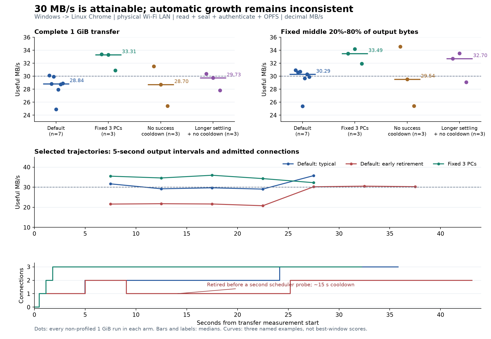

# WebRTC throughput bottlenecks

2026-10-24. Investigation of the current [throughput implementation](../../../../docs/plans/webrtc-throughput.md).

The complete pipeline can exceed 30 MB/s on this LAN. Its automatic policy does not do so reliably: growth waits too long after success, and a new path can be retired before the scheduler gives it another useful probe. Separately, wall-time measurements locate most single-connection send-loop time inside synchronous Windows UDP submission. No production change is adopted from this study.

## Measurements

39 attempts: 38 completed with matching output hashes and published output; one invalid four-path control. Five completed runs carry CPU/queue instrumentation and are excluded from speed comparisons. Two are same-host controls. Runs were serial, without concurrent builds/tests.

| Physical LAN, OPFS | Runs | Activation-to-close MB/s, median | Middle 20–80% MB/s, median |
|---|---:|---:|---:|
| 256 MiB, single PC, alternating pairs | 4 | 20.98 | 21.69 |
| 256 MiB, automatic, alternating pairs | 4 | 23.65 | 27.96 |
| 1 GiB, automatic | 7 | 28.84 | 30.29 |
| 1 GiB, fixed two PCs | 1 | 28.27 | 28.81 |
| 1 GiB, fixed three PCs | 3 | 33.31 | 33.49 |

Automatic 1 GiB results span **24.90–30.12 MB/s** overall and **25.39–30.93 MB/s** in the middle. Fixed three-PC results span **30.89–33.38** overall and **31.93–34.20** in the middle. This establishes sustained average capacity, not a minimum instantaneous rate: two three-PC runs have an interior five-second interval of 27.16 and 29.34 MB/s; the other remains at 32.26–35.95 MB/s across all recorded interior intervals.



The [results](results.json) retain every arm, failure, output hash, selected-pair properties, decision, timing summary, profile, raw-artifact hash and source identity. [Public export](../evidence_export.py) removes or aliases lab addresses, local paths, credentials, raw logs and connection identifiers. Measurements are unchanged; measurement-time hashes identify private originals under ignored `.tmp`, and some artifact paths are anonymized. [SVG](throughput.svg) is available for export.

## Bottlenecks and evidence

### Automatic growth and allocation observe different things

[The controller](../../../../web/src/connectivity/peer-set/throughput.ts) measures three-second aggregate windows and applies a 15-second cooldown after both success and failure. Typical admission is one PC near 0.6 s, two near 5 s, and three near 24 s. A 256 MiB file finishes before the next growth opportunity; even a 1 GiB transfer spends most of its first half with only two PCs.

The seven-run series also exposed premature retirement. In `confirmation-6-large-original-4`, the first optional path receives only three blocks at 4.48–4.69 s. One completes in 211 ms, one loses to rescue after receiving 196,320 bytes, and one takes 966 ms. The allocator then favors the initial path. The controller sees 21.43 MB/s against a 21.48 MB/s baseline, retires the optional path, and holds one PC until roughly 25 s. Its replacement later carries 261 blocks and produces a measured aggregate gain.

[Allocation](../../../../web/src/content/scheduling/selection.ts) waits [five seconds](../../../../web/src/content/scheduling/exploration.ts) before probing a slow path again. The controller's three-second trial can end before that opportunity. Counting admitted connections is therefore insufficient evidence that an added path had representative work. `underSampledTrial` retains exact dispatch epochs and block timings; lane IDs can be reused after retirement.

Two diagnostic policy overlays tested the obvious constant changes, each against three alternating-order default runs:

| 1 GiB diagnostic policy, three runs each | Overall median MB/s | Middle median MB/s | Middle range |
|---|---:|---:|---:|
| Remove cooldown after successful growth | 28.70 | 29.54 | 25.41–34.56 |
| Also extend settling from 1 s to 5 s | 29.73 | 32.70 | 29.08–33.52 |

Neither consistently resolves the problem. Fixed three PCs are a capacity control, not the proposed production policy. The current four continuation slots reserve one for recovery, so at most three throughput PCs are intended. The initial four-PC control repeatedly attempted inadmissible growth and failed its harness assertion (`17 !== 4` created PCs); it supplies no valid throughput result.

### The single-PC sender spends most of its time submitting UDP

[Pion SCTP](../../../../third_party/pion/sctp/association.go) serially calls the underlying connection for each packet. The diagnostic build times this existing call and the underlying [UDP write](../../../../third_party/pion/ice/addr.go), without replacing either.

In a 10.9-second interior single-PC window, 192,239 SCTP writes spend **9.27 s (85.1%)** inside the send call. Underlying UDP writes spend **7.89 s (72.4%)**, averaging **41.0 µs/datagram**. Three PCs overlap their send loops; each spends 43.7–50.8% of its window sending. The 7.28 s aggregate UDP-call duration in that three-PC window overlaps across connections and must not be described as elapsed wall time.

This identifies a local synchronous-send bottleneck, but does not separate Windows kernel, driver, filter and scheduling contributions. It is fresh evidence for a bounded native-submission experiment against the complete product. The older fixed-timeout overlapped prototype remains unadopted.

The single-PC queue profile has approximately 5.04 MiB congestion window, 3.94 MiB receive window, 0.56 MiB in flight and 12 ms RTT, with no T3 timeouts in that run. It does not support a universal small-SCTP-window explanation for the 20 MB/s plateau. Multi-PC runs have smaller congestion windows and some retransmissions, so network contention is still relevant to their ceiling.

### Controls narrow the other suspects

- Memory output versus OPFS at 256 MiB changes the three-PC result only from 27.95 to 28.51 MB/s; two PCs give 27.66 versus 27.72. These are single exploratory controls, not precise effect estimates. Bare 64 MiB OPFS writes have a 339 MB/s median across 36 runs.
- TCP controls around the LAN transfers have a 56.10 MB/s median, with a 27.36–59.35 range. The slow 24.90 MB/s automatic run is bracketed by 56.10 / 59.35 MB/s controls. This excludes a fixed 20 MB/s path cap, not transient Wi-Fi variation.
- Same-host Windows-to-Edge full-pipeline controls reach 48.64 / 48.63 MB/s from activation to close with one / three PCs. These change the network path and receiver platform; they are not physical LAN evidence.
- CPU profiles leave roughly half the browser main thread idle. Native allocation is high (about 6.6–6.9 GB per 256 MiB transfer), while GC stop-the-world pauses total about 9–13 ms in the non-wall profiles. Allocation is worth reducing, but these controls do not establish encryption, GC or output as the dominant 20 MB/s limiter.

## Architectural direction

Expose per-path **generation, offered work, settled work and sampling readiness** from content scheduling to connection trials. Distinguish an under-sampled path from a measured capacity failure. Begin aggregate useful/output evaluation after representative eligible work has run; coordinate retry opportunities with scheduler probing. Successful growth should not inherit the same penalty as failed growth. Preserve output-frontier priority, recovery reserves and cancellation settlement rather than assigning fixed traffic shares.

For native submission, compare a bounded completion-aware implementation with the same frozen full pipeline. Socket ownership must retain cancellation, deadlines and close semantics. Increasing buffers, globally increasing MTU, or copying the old prototype's fixed timeout is not justified by this evidence.

## Scope and reproduction

One i7-14700KF Windows desktop sends to Linux Chrome 155.0.8059.84 over the physical Wi-Fi LAN. Selected direct host/UDP pairs are checked against the intended two hosts. SSH/CDP only controls the browser. Native file reading/sealing, protocol authentication and ordered OPFS output are active; the existing test plan-settlement adapter supplies the output artifact. This is not UI, crash/resume, reverse-direction or public-route evidence.

MB/s is decimal. Overall timing starts at content-connectivity activation and ends at writer closure; earlier join/catalog setup and subsequent full-file SHA-256 are excluded. Middle throughput always uses the fixed 20%–80% cumulative output range, interpolated between completed writes. Profiling overhead is excluded from performance aggregates.

The frozen build is `webrtc-bottleneck-20261024-baseline`, based on dirty revision `efb481bfd2398206509ad93040c69f17000010bf`; [4,177 file hashes](sources.json) identify its actual content. All physical-browser cleanup acknowledgements are complete; no local study processes remain. Raw data and generated Go/JS overlays remain under the ignored build directory. JavaScript/Python syntax checks and `make hygiene` pass. The Git index is unchanged, and frozen production sources still match the working tree; only this research directory and the plan were edited.

With the existing lab settings in `.tmp/webrtc-preflight-20261023/lab.json` and installed browser dependencies:

```powershell
$env:WS_ADAPTIVE_BUILD = 'webrtc-bottleneck-new-run'
python testdata/connectivity/webrtc/adaptive-20261023/prepare.py
python testdata/connectivity/webrtc/bottleneck-20261024/prepare-fixture.py
python testdata/connectivity/webrtc/bottleneck-20261024/prepare-profile.py
$env:WS_BOTTLENECK_PROFILE_FLAVOR = 'wall'
python testdata/connectivity/webrtc/bottleneck-20261024/prepare-profile.py
Remove-Item Env:WS_BOTTLENECK_PROFILE_FLAVOR
node testdata/connectivity/webrtc/bottleneck-20261024/matrix.mjs trial-window testdata/connectivity/webrtc/bottleneck-20261024/cases.json
```

`cases.json` also contains `screen`, `long-and-profile` and `confirmation`. The initial four pairs use the preceding `adaptive-20261023/matrix.mjs large-initial` driver. Suites refuse to overwrite ledgers. `analyze.py`, `profiles.py` and `wall.py` summarize raw runs; `archive.py` archives this complete study after all suites, and `plot.py` renders the retained JSON using matplotlib. Early drivers import the policy overlay; later drivers freeze its source and hash. Diagnostic policy branches did not change the original/fixed-path arms.
