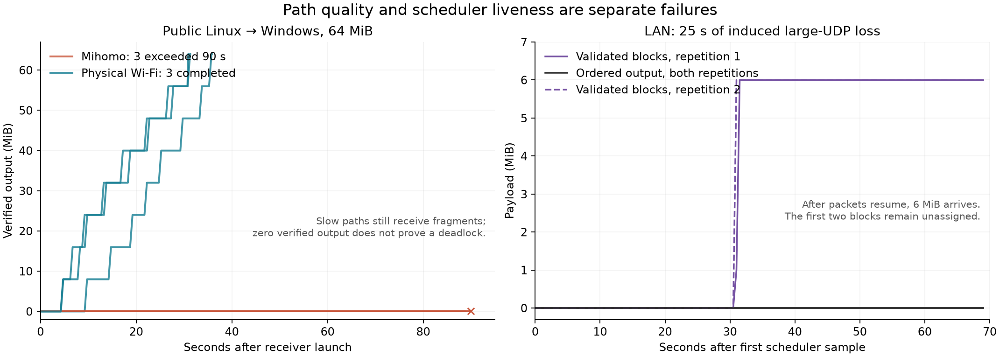

# Native WAN stalls and throughput — 2026-10-24

51 native CLI transfer attempts on frozen revision `c6419c5885c01a70e1c2d85d7732a8cef12c300c`: **41 successful exits and 10 failures**. Three failures nevertheless published complete, SHA-256-correct files. All attempts are retained. Findings separate poor network paths, a permanent scheduler wait, completion semantics, and native LAN congestion.

This study changes research harnesses only. Diagnostic Go overlays run against a frozen snapshot; they are not production fixes.

## Decisive controls

| Scenario | Attempts | Result |
|---|---:|---|
| Public Linux → Windows, 64 MiB, physical Wi-Fi candidates | 3 | All complete in 30.97–35.89 s |
| Same transfer, Mihomo candidates | 3 | All exceed 90 s; no verified output |
| Public Linux → LAN Linux, physical Wi-Fi candidates | 2 | Both complete, 72.06 / 76.41 s |
| LAN reverse, 25 s large-datagram loss, `p2p-only` | 2 | Both still stuck at the 70 s cutoff after packets resume |
| LAN reverse, same fault, `auto` | 3 | All files complete and hash correctly; all exits fail during lease release |
| LAN reverse, clean `auto` controls | 2 | Both complete successfully |
| Linux → Linux on one machine, 256 MiB | 1 | Correct file in 4.406 s: 60.92 MB/s |

“Reverse” means remote Linux shares and local Windows downloads. Forward swaps those roles. Linux-to-Linux rows are explicitly separate topologies.



## Public path selection is a real performance problem

The forced-interface series uses one instrumented binary and order **Mihomo, Wi-Fi, Wi-Fi, Mihomo, Mihomo, Wi-Fi**. Only candidate interfaces change; global proxy/routing configuration stays intact. The three slow senders have median SCTP RTTs of **340 / 351 / 357 ms**, final congestion windows of **13,066 / 8,232 / 13,521 bytes**, and only **1.87–2.48 MB** sent after approximately 86–87 seconds. Send calls consume under **0.08%** of each association's sampled lifetime. Pending send data and free receive windows coexist with the small congestion window. This locates the immediate limit in the selected data path and SCTP congestion control, rather than an empty encryption queue or blocked output.

An uninstrumented reverse run also exceeded 180 s after selecting the Mihomo address. Its healthy control traffic and zero verified bytes alone do not prove a scheduler deadlock: authenticated fragments can keep a block's inactivity timer alive. An unrestricted Linux-to-Linux reverse run likewise exceeded 180 s on a different public exit; its sender had a roughly 10 KiB window and 423 ms final RTT. The two physical-interface Linux repeats completed. One forced-Mihomo **forward** run completed in 39.67 s, so this is not a claim that every proxy or direction fails.

The [growth controller](../../../../connectivity/throughput/controller.go) requires positive useful and output progress before exploration. A first path that passes connectivity checks but cannot finish the first block can therefore remain selected without throughput exploration rescuing it. Recovery needs its own data-progress signal and bounded alternatives within the configured route policy. The experiment does not justify a blanket VPN blacklist, nor identify the proxy backend's internal fault.

## A recovered connection can leave native downloads waiting permanently

The diagnostic sender discards datagrams larger than 500 bytes for 25 s after its first 64 large datagrams. Smaller connectivity checks continue. This is a controlled data-path fault, not a complete host outage.

In both real LAN repetitions, the first two block attempts time out around 15 / 30 s. After the fault ends, six later blocks validate, but the first two remain queued with **no in-flight work, no unfinished receive bytes, and zero output** until the 70 s harness cutoff.

[Allocation](../../../../core/transfer/lanes/allocation.go) treats a route permanently forbidden by `p2p-only` as temporarily suspended. The already-attempted direct generation is excluded; the forbidden relay keeps the candidate set “possibly resumable.” Allocation never surfaces exhaustion. The pending demands are marked route-blocked, so the throughput controller also lacks network demand and output progress.

[The deterministic reproduction](route-exhaustion_test.go.txt) exercises `Set.Fetch` with typed transport-inactivity failure. It fails **five of five** repeats with a forbidden relay; a direct-only control surfaces exhaustion. Separating permanent policy exclusion from temporary suspension makes all five experimental control repeats pass. This proves the classification defect, **not complete network recovery**. A production repair must reconcile exhausted demand, exact-generation retirement and recovery admission. The first fixture incorrectly used plain context cancellation and did not reproduce this branch; its rejected result is retained in the evidence.

## Lease cleanup changes a completed download into “paused”

All three faulty `auto` runs publish a 64 MiB file matching the expected hash, then spend five seconds awaiting `release_lease` and exit 1 with “Download paused.” Completion times are 8.45 / 20.58 / 7.83 s. The two clean controls pass.

[The output workflow](../../../../core/transfer/job_output.go) accepts publication before releasing the revision, then propagates a terminal release failure into job pause. [Existing tests](../../../../core/transfer/job_file_settlement_fault_test.go) encode this behavior. This is a completion-model problem: confirmed publication and remote cleanup need distinct outcomes. Cleanup still needs bounded ownership and diagnostics; it must not imply that a verified published file remains unfinished.

## Native LAN throughput: receive loss is real, but larger buffers are insufficient

The complete native workflow reaches **60.92 MB/s on one Linux host**, establishing capacity above 40 MB/s in that control only. It does not establish cross-machine throughput.

The first additional Windows → Linux LAN run increases Linux UDP receive-buffer overflow counters by 248. A subsequent alternating three-pair experiment fixes both physical interfaces and changes only Linux `SO_RCVBUF` in the same diagnostic binary:

| Requested socket buffer | Effective Linux buffer | Runs | Overall median MB/s | Receive-buffer drops per run |
|---|---:|---:|---:|---|
| Unchanged default | 212,992 bytes | 3 | 11.21 | 76, 7, 23 |
| 4 MiB | 8,388,608 bytes | 3 | 11.74 | 0, 0, 0 |
| 256 KiB | 524,288 bytes | 1 exploratory | 9.88 | 0 |

The default-buffer drops are independently attributed to **WindShare's own socket inodes**, matching the system counters exactly. Linux allows a 4 MiB request and reports twice that value; no sysctl or privileged configuration was changed. Socket buffers are currently left to the system default by [socket allocation](../../../../connectivity/socketauthority/authority.go).

The larger buffer removes this loss source, but the median gain is only **4.7%**, and one of three pairs becomes slower. The smaller exploratory setting also removes overflow without improving throughput. [Every point is plotted](receive-buffers.png); larger buffers alone do not explain or solve the full speed gap.

With overflow eliminated, sender associations still show fast retransmissions, median congestion windows around **27–57 KiB**, in-flight bytes close to those windows, and pending data. Their send calls occupy about **5–13%** of sampled association lifetimes. The remaining immediate limit is congestion-window availability on the network path. These observations do **not** distinguish the remaining packet loss/reordering among Wi-Fi, driver and receive/protocol processing; packet-level attribution remains open. They do not support treating Windows synchronous UDP submission as this native run's dominant bottleneck.

[Earlier browser measurements](../bottleneck-20261024/README.md) used a different receiver and identified substantial Windows send-call overhead. [The subsequent sampling refactor](../sampling-20261024/README.md) already changed trial allocation. Neither older bottleneck should be asserted unchanged for the native experiments here.

## Priorities and evidence

First repair permanent route waiting and completed-file settlement. Then connect data-path health to recovery, independently of optional throughput growth. Native socket buffering should be measured and budgeted by the socket owner, with effective sizes and per-socket drops observable. Any subsequent throughput work should explain the residual retransmissions and compare complete transfers; fixed connection counts and blanket buffer increases are not established solutions.

- [Uninstrumented attempts](baseline-results.json), [diagnostic/fault attempts](diagnostic-results.json), [interface/settlement/LAN controls](interface-results.json), [buffer controls](buffer-results.json).
- [Derived facts and complete ledgers](derived-results.json) include source hashes, exact cases, queue states, socket counters, timing and reproduction results. [Verification](verification.json) records checks and source preservation.
- Raw traces, goroutine dumps, copied harnesses, source manifests and diagnostic overlays remain under ignored `.tmp/webrtc-wan-stall-20261024-{current,diagnostic,interface,buffer}`. Exported evidence uses the repository's existing public projection; measurement values and original-file hashes are preserved.
- One public Linux host and one Wi-Fi LAN Linux host were usable. The second configured public host failed authentication and was not tested. No browser WAN performance, universal success rate or cross-machine 40 MB/s result is established.
- Transfers run serially, without concurrent builds/tests. Instrumented rates are kept separate from the uninstrumented baseline. MB/s is decimal; times include receiver-process startup and final cleanup, excluding fixture preparation and post-publication hashing. Harness cutoffs of 70/90/180 s differ from protocol inactivity and lease-release timeouts.
- In `p2p-only`, SSH carries bootstrap/signaling only. In `auto` and `relay-only`, application-relay content crosses the harness's SSH tunnel. These runs establish fallback/settlement behavior, not production public-relay performance.

## Reproduction

Use installed Go/Rust/Python dependencies, the existing LAN SSH settings in `.tmp/webrtc-preflight-20261023/lab.json`, and a configured public SSH profile. Choose fresh build and suite names; they resolve to `.tmp/<name>_stignore` (Syncthing-ignored), and the drivers refuse to overwrite ledgers. Edit case interface names to match the target hosts.

```powershell
$env:WS_ADAPTIVE_BUILD = 'wan-research-new'
python testdata/connectivity/webrtc/adaptive-20261023/prepare.py
$study = 'testdata/connectivity/webrtc/wan-stall-20261024'
python "$study/matrix.py" "$study/baseline-cases.json" --build wan-research-new --name baseline --public-endpoint PROFILE
python "$study/prepare-diagnostic.py" --base wan-research-new --name wan-research-diag --interface-filter --socket-buffer
python "$study/matrix.py" "$study/diagnostic-cases.json" --build wan-research-diag --name diagnostic --public-endpoint PROFILE
python "$study/matrix.py" "$study/interface-cases.json" --build wan-research-diag --name interface --public-endpoint PROFILE
python "$study/matrix.py" "$study/settlement-cases.json" --build wan-research-diag --name settlement --public-endpoint PROFILE
python "$study/matrix.py" "$study/lan-confirmation-cases.json" --build wan-research-diag --name lan-confirmation --public-endpoint PROFILE
python "$study/matrix.py" "$study/buffer-cases.json" --build wan-research-diag --name buffer --public-endpoint PROFILE
python "$study/reproduce.py" --build wan-research-new --name route-exhaustion
```

For per-socket attribution, run `observe-sockets.py --build wan-research-diag --ledger buffer-ledger.json` in a second terminal before the buffer matrix. It samples only study-owned UDP sockets and cleans up its remote directory. `analyze.py BUILDS... --output FILE` exports runs; `derive.py` additionally links ledgers and scheduler/socket samples (deterministic reproductions default to the first build, or `--proof-build`). `plot.py` renders the exported JSON. Python syntax checks and `make hygiene` pass; the expected baseline failures in the deterministic reproduction remain part of the findings.
